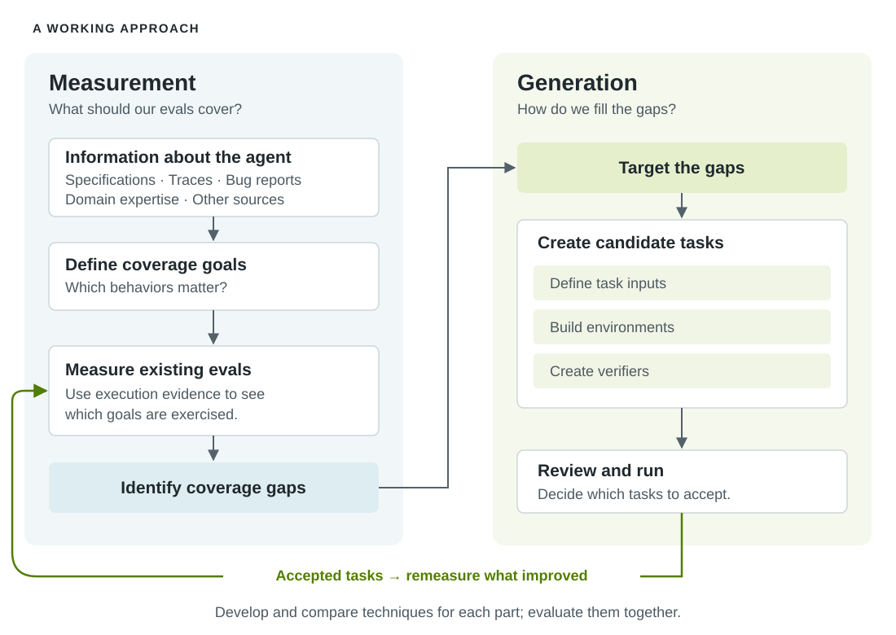
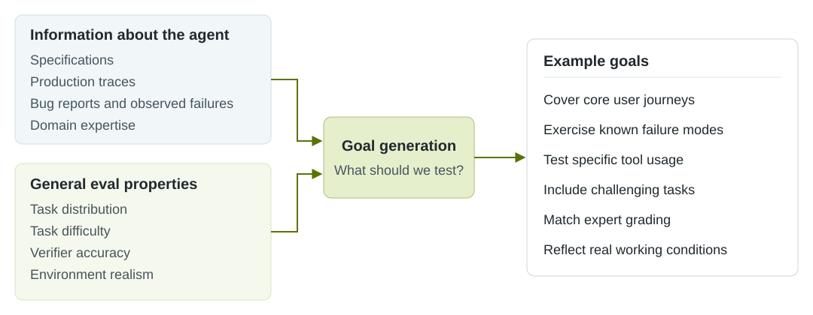

<!-- SPDX-FileCopyrightText: Copyright (c) 2026 NVIDIA CORPORATION & AFFILIATES. All rights reserved. -->
<!-- SPDX-License-Identifier: Apache-2.0 -->

# Introducing Eval Author

Helping developers build the evaluations that make agents work.

**October 15, 2026 · Introduction**

## Hello, world!

Hello from the Eval Author team! We're working on making it easier for
developers to create useful evaluations for their agents and understand where
those evaluations fall short.

We think agentic evaluations are at the core of building good agents. They
turn domain expertise and expectations into something we can test, tell us
whether a change helps or hurts, and provide the feedback signal for
optimization. If we're asking an agent to improve its own prompts, tools, or
code, its evaluations help determine what "better" means. We want to make that
feedback something developers can trust.

Our objective is to help developers (1) understand whether their agentic evals
are "good" with respect to their agent and (2) create new evals as needed!

Doing this well across different agents and domains is still an open problem,
and a big one at that. A coding agent, a customer-service agent, and an
engineering design agent have different responsibilities, environments, and
definitions of success. Generating evals for software as complex as modern AI
agents is challenging along many axes.

We're therefore committed to working with the open-source community and
building in public. Dev Notes is where we'll share our latest announcements,
research, and lessons learned. Our latest work will be shared in our Eval
Author research repo.

## Creating Evals: Harder Than It Looks

Agents need evaluations, but many developers are new to building agentic evals
and to evaluation science more broadly. Knowing that you need evals doesn't
tell you how to build a useful set, or how to know when it's good enough.
There's no clear, widely accepted metric that tells us how good an evaluation
set is for a particular agent. Advice often comes down to trying things and
seeing whether they work in practice. That matters, of course, but it leaves
developers with a lot of trial and error just to get started. The process can
feel more like an art than a science.

Much of the best expertise in evaluation goes into building large benchmarks.
There's a lot to learn from that work, but the goals aren't quite the same.
Research benchmarks typically aim to measure progress in machine learning and
compare the capabilities of different systems. A team building an agent for
its business has a more specific question: does our software work the way it's
supposed to? Answering that means capturing the team's own workflows,
expectations, and failure cases.

We think there's room to make this much easier. The tooling and guidance
available today can make it hard to find a starting point and leave too much
of the process feeling like magic. We want to help developers make concrete,
informed decisions about their evals and build confidence in them as they go.

## Introducing Eval Author

[Eval Author](../../../README.md) is our test bed for exploring how to
understand and create agentic evals. We want to bring together promising
techniques for measuring and generating evals, try them on concrete case
examples, and turn what we learn into tools developers can use.

Understanding and generating agentic evals is a *big problem*, and we're
therefore decomposing the work into a few connected problems: deciding what an
evaluation set should cover; measuring how well it covers those goals; and
generating tasks to fill the gaps. Each gives us something we can study and
improve independently, then combine with the other pieces.

To learn whether these ideas work, we need good case examples: agents with
meaningful work to do, environments where we can run them, and existing
evaluations we trust enough to use as a reference. We also need variety. An
approach that helps a coding agent might need something quite different to
work for an engineering design agent.

We don't yet have the range of case examples or the benchmarks for eval
generation that we'd like. Building that collection is part of the research,
and a reason we're interested in working with teams who bring real agents,
domain expertise, and evaluation problems of their own.

## Breaking Down the Problem

Our working approach separates **measurement** from **generation**.

*One way to break down eval authoring. Each stage is a place to develop and
compare approaches; the loop lets us study how they work together.*

### Measurement: What is "Good" Anyway?

The "goodness" of an agentic eval is an inherently squishy concept, but it
should ultimately help answer the question: *does this agent do what it
should?*

Different sources of information give us different views of what an agent
should be doing. Specifications describe intended behavior, production traces
show the work users actually ask it to do, and bug reports highlight where
things go wrong. Domain expertise helps us interpret those sources and spot
what's missing. Alongside that information, there are properties we'd want
from any good eval set, such as accurate grading and realistic environments.

Our task is to turn this information into a set of goals. If we met all of
them, we should have good reason to believe we'd built a useful evaluation set
for the agent. We use *coverage goals* as a starting point, but the things we
care about go beyond whether a particular behavior appears in a task.

There are several properties we want these goals to encompass:

- **Task distribution.** Does the set cover core user journeys, edge cases,
  and known failures, informed by traces, specifications, and bug reports?
- **Task difficulty.** Are tasks challenging enough to guide improvement?
  Model laddering—comparing results across models with different
  capabilities—offers one possible signal.
- **Accuracy of verifiers.** Do the checks agree with domain experts about
  which solutions should pass or fail, including when a model does the
  grading?
- **Environment realism.** Do the tools, data, and starting conditions reflect
  real use? What counts as sufficiently realistic remains an open question.

The hard part is moving from subjective properties we'd like an eval set to
have to things we can objectively measure. Some goals can be derived fairly
directly from the available information; others need experiments or better
definitions before we can measure them. Defining a goal and finding a
trustworthy way to measure it are both part of the work. We need progress on
both before a metric can tell us how good an evaluation set really is.

### Generation: Turning Goals Into Evals

On the **generation side**, gaps against those goals give us a target. We can
break task creation into three parts:

- Defining the input that asks the agent to do something
- Constructing the environment it will work in
- Creating the verifier that checks success

This is a tentative breakdown of task creation. There are plenty of things
that make generation difficult, and we expect to discover more as we apply
these techniques to different agents and domains. Some will deserve to be
studied as problems in their own right. We want the breakdown to evolve with
what we learn, giving us smaller problems we can tackle and improvements we
can bring back into the overall process.

Each part needs to preserve what we set out to test. A task about recovering
from a tool failure, for example, needs an environment where that failure can
happen and a verifier that checks whether the agent recovered successfully. We
then review and run candidate tasks, returning accepted tasks to measurement
to see what improved.

One observation that initially motivated this work was how readily frontier
coding agents took shortcuts while trying to make evaluations pass or achieve
coverage. In our experiments, simply providing a detailed, carefully
considered list of what an eval set should do hasn't reliably produced good
evaluations. A task can run and pass while missing the behavior we wanted to
test: an environment might reveal the answer, or a verifier might accept a
shortcut. Breaking generation into smaller parts gives us places to look for
these problems and test ways to address them. Understanding which checks we
can automate is part of making the approach useful.

### Just Getting Started

This is a starting approach for our work. It gives new approaches a place to
fit: we can try a different source of coverage information, a new metric, or
another technique for building environments without rebuilding all the
tooling. We can work on each problem independently, then evaluate the impact
of each piece individually, eventually identifying the most effective combined
approach against our case examples.

Our current implementation is focused on spec-based coverage, where we define
the behavior of the agent in semi-formal language and then generate coverage
goals against this specification. Generation then produces Harbor tasks,
leveraging existing coding agent CLIs to build the evaluation. Initial results
are promising, demonstrating that Eval Author, for the small number of case
examples we've tested it against, outperforms a raw, unguided coding agent. We
plan to expand our studies and share these results in a future dev note. Our
initial implementation is available in the repository.

**A friendly warning:** It's early! The experiments we run indicate that this
is useful, more useful than just a standard coding agent, but don't YOLO with
a coding agent and expect magic. Treat it as a guide to accelerate your work
to get to a better outcome. And if you have suggestions, thoughts, or
potential improvements, please share!

## Parting notes

We're just getting started. These dev notes are where we'll share our
experiments, the case examples we're building, and the lessons we learn along
the way. If you're building agents and wrestling with how to evaluate them,
we'd like to hear from you.
