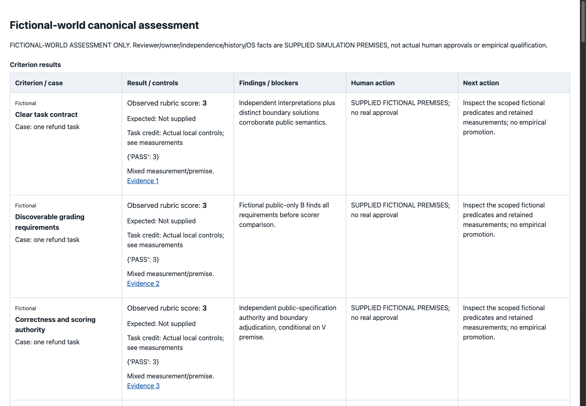

<!-- SPDX-FileCopyrightText: Copyright (c) 2026 NVIDIA CORPORATION & AFFILIATES. All rights reserved. -->
<!-- SPDX-License-Identifier: Apache-2.0 -->

# Reading the experimental rubric demo

- Read a worked assessment of a refund task and its companion suite.
- Compare a base task with deliberate mutations in a separate summary.
- Follow each score to its evidence and required next action.

**November 19, 2026 | Experimental rubric**

The experimental Eval Author rubric asks specific questions about an evaluation's evidence. Can the solver find the grading requirements? Does the scorer enforce the stated contract? Does the evidence still match the task revision? The report keeps these answers separate. It does not produce an overall evaluation quality score.

Start with the [refund task scenario command](../../determinism-checks.md#fictional-task-scenario). Open `source/execution/report.html` in the output directory. The Markdown report and structured assessment sit beside it.

The source report calls this a "fictional-world assessment." It uses the current rubric, not a separate fictional rubric. The example supplies reviewer decisions and approval records alongside executed refund controls. Those records let the example show criteria that need review as well as execution evidence.

## Read a criterion before reading a score

A criterion has a question, named checks, evidence requirements, and scoring anchors. The anchors define what a score means for that criterion. A count of passing checks does not supply a general scoring rule.

For example, `task-contract.clear-contract` asks whether independent readers can resolve the goal and grading boundaries from the public or discoverable contract. These anchors are an excerpt from the [canonical task-contract definition](../../../skills/eval-author-rubric/references/task-contract-authority.json), not observed demo scores.

| Score | Canonical anchor for clear task contract |
| --- | --- |
| 0 | Material contradiction or underspecification prevents justified grading |
| 1 | Material ambiguity remains unresolved |
| 2 | Public/discoverable contract and assumptions resolve material ambiguity |
| 3 | Independent solutions and boundary cases support interpretation |

The checks for this criterion keep a cited requirement and ambiguity register, an independent interpretation and disposition, and boundary-case rewards and health. The [scoring rules](../../../skills/eval-author-rubric/references/task-contract-authority.md#scoring-rules) also require human adjudication for level 2 and independent corroboration for level 3. Missing or unrun evidence leaves the criterion Unassessed. It does not establish a contradiction or a zero.

In the report, read the observed score with its reason. Then open the evidence details and read the next action. A recorded review requirement is not a completed approval. Task credit is also separate. It records the task scorer's result rather than the rubric's assessment of the evaluation.

## Keep task and suite evidence separate

The current demos cover 23 defined criterion rows. The 19 task-level rows assess one evaluation. The 4 suite-level rows need other tasks, task families, or selection history. They never contribute to a single task's score. METHOD-J1 remains undefined and is outside this count. The [canonical level definitions](../../../skills/eval-author-rubric/references/leakage-and-credit.md#task-and-suite-levels) identify the split.

The worked example includes a refund task and two companion task families. Local controls measure task behavior, rejected inputs, and source/evidence bindings. The report records the supplied review and approval evidence separately.

The example reaches the top anchor for each applicable criterion. Exploit containment is N/A because the controls found no confirmed exploit to contain. Open a criterion's evidence to see the checks and review records that support its result.

## Compare mutations in the summary

Use the [offline mutation command](../../determinism-checks.md#rubric-mutation-demo) when you want to see how deliberate changes affect the rows. This separate runner compares the refund base with 21 mutations and writes `summary.md`, `summary.json`, and `runs.json`. It does not emit the fictional scenario's full per-check HTML report.

Start with the intended change, observed score, and reason in `summary.md`. Then check collateral changes and the separate task-level and suite-level tables. The base target is 3 on 18 task rows, with AUDIT-04-B N/A because no exploit is confirmed. Suite rows stay Unassessed or N/A unless the single-task evidence exposes a defect. The runner checks repeated results and requires each mutation to rank below the base. Unassessed remains distinct from a measured score drop.

Keep `--offline` for the recorded model responses. Local controls still run again. A cache miss fails rather than calling a model. Without that flag, a cache miss can launch a fresh model session, but a cache hit still reuses the recorded response. Model use requires separate permission. Cached judgments and the simulated owner policy are not human approval.

The mutation demo's `provenance.runtime-route` score of 3 uses a weaker reading than its [canonical anchor](../../../skills/eval-author-rubric/references/artifact-configuration-provenance.json). Harbor validates the manifest and rejects an invalid one. The demo performs no clean environment setup or adapter run. Read that limit with the score rather than treating it as proof of runtime readiness.

## Use the result for the next review

For your own evaluation, explicitly opt in to [eval-author-rubric](../../../skills/eval-author-rubric/SKILL.md#opt-in-gate) for the selected scope. A generic review request does not enable it. Execution and write permissions remain separate from that opt-in.

Use the [report guide](../../results.md#rubric-demo-reports) to find evidence and verification results. The [scenario source](../../../tools/rubric_task_scenario/run.py) and [mutation source](../../../tools/rubric_sim_demo/run_demo.py) show the two entry points. Keep the base assessment and mutation comparisons together when presenting the rubric. Each comparison must retain its own baseline and criterion-level evidence.
