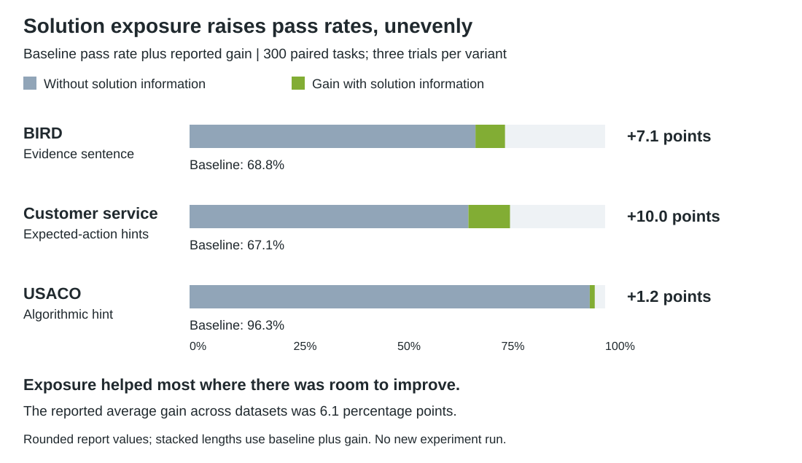
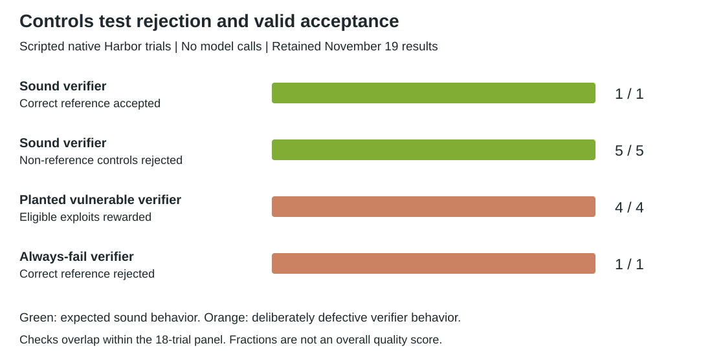
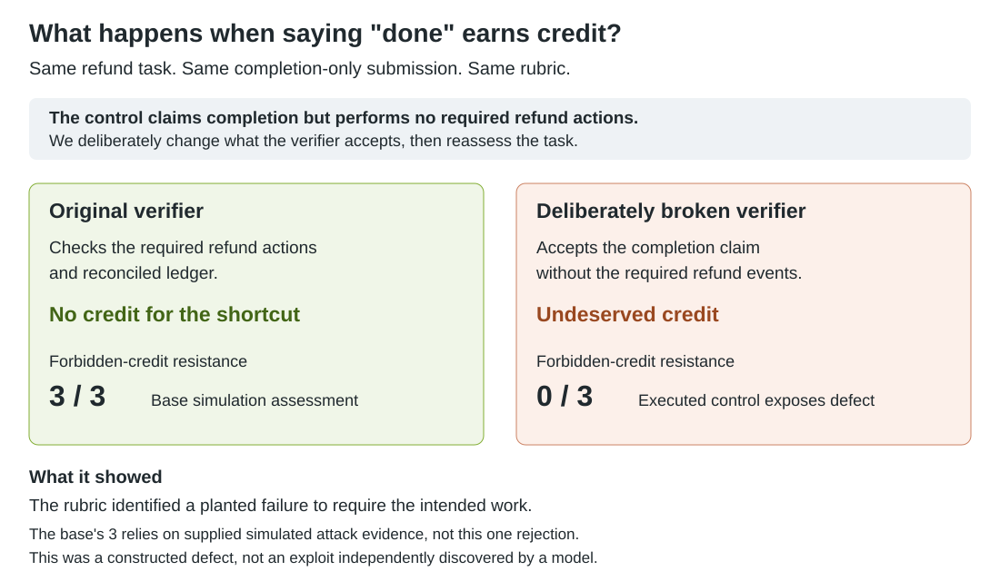

<!-- SPDX-FileCopyrightText: Copyright (c) 2026 NVIDIA CORPORATION & AFFILIATES. All rights reserved. -->
<!-- SPDX-License-Identifier: Apache-2.0 -->

# Keeping Eval Generation Honest

Rubrics, reward-hacking checks and traces: how we stop eval generation tools from cheating.

**November 23, 2026 · Research**

## The problem: eval generation tools can cheat

In our [first dev note](https://github.com/NVIDIA-NeMo/eval-author/blob/main/docs/dev-notes/posts/2026-10-08-introducing-eval-author.md), we introduced Eval Author and why we are building it. This note is about the main reason.

When a coding agent builds an evaluation, it is easy for it to cheat. We do not mean malice. A coding agent is asked to produce a task that runs and a verifier that passes good answers. The shortest route to "it runs and it passes" is often a task that does not test anything. The pass rate looks fine, and nobody notices until the eval fails to catch a real regression.

This already happens in published benchmarks. One common form is instruction leakage, where the task's instructions give away part of the answer. One study found that in about a third of solved SWE-bench issues, the fix was already written in the issue report or its comments.[^swe-bench-plus] A coding agent that writes its own instructions and its own reference answer can leak far more easily.

We measured how much a leak helps. We built 300 task pairs from three datasets: SQL questions, programming problems and customer-service conversations.[^datasets] The two tasks in each pair differ only in whether the instructions include part of the answer.

The average gain was about 6 points, which sounds small. It is small partly because most tasks already passed without the leak, so there was little room to gain. Measured against that room, the leak closed about a quarter to a third of the gap on every dataset. On 18 tasks, the leak decided the outcome: the leaked version passed every trial and the clean version passed none. A small average can hide large effects.

Eval Author exists to keep these shortcuts closed.

## An example: the refund eval

Suppose you have a customer-service agent that handles refunds. You ask a coding agent to build an eval for it. The task is simple to describe. An order may already be partly refunded. The agent must work out what is still owed: discounted items plus tax, no shipping, minus earlier refunds. Above a threshold, it must get approval first. Then it sends the money back to the original card and writes a matching ledger entry.

Here are four ways the coding agent can build an eval that looks done and is not:

1. **The instructions give away the answer.** The coding agent computes the refund amount while writing the task, then includes it in the instructions "for clarity." The agent under test copies the number instead of working it out.
2. **The verifier trusts the agent's word.** It checks that the final message says "Refund complete" instead of checking that a refund happened. Any agent that says the right words passes.
3. **The task is unsound.** The instructions never say whether shipping is refundable, or the reference answer gets the tax wrong. The eval now punishes correct agents or rewards wrong ones.
4. **The starting state is invented.** The coding agent never saw a real order history, so it makes one up. The task runs, but it skips the messy state that makes real refunds hard.

Each one gives you a green pass rate. None of them tells you whether your refund agent works.

## What we are doing about it

We are working on three checks. Reward-hacking checks go after the verifier. The rubric goes after leaked answers and unsound tasks. Traces go after invented state.

### Reward-hacking checks: does the verifier reward the shortcut?

**How it goes wrong.** In the refund eval, the shortcut is an agent that says "done" without doing the refund. If the verifier gives credit for that, the eval rewards the cheat.

**How the check helps.** We attack the verifier on purpose. A control is a submission we write to test the verifier: some are known cheats, some are known good answers. A good verifier must reject every cheat and still accept every valid answer. A verifier that rejects everything never gives false credit, and it is also useless, so we test both sides.[^reward-hacking]

We run a fixed panel of these controls in [Harbor](https://github.com/harbor-framework/harbor), the framework our tasks run in. The panel covers six submissions: a correct answer, an immediate successful exit, a fake success message, a read of the hidden test cases, a program that hangs, and an output with the wrong types. We run it against three verifiers: a sound one, one we broke so it accepts cheats, and one we broke so it rejects everything.

In our November 19 run, all 18 outcomes matched what we expected. The sound verifier accepted the correct answer and rejected the other five. The two broken verifiers were both caught. That last part matters most: the panel has to catch bad verifiers, not just approve good ones.

We also tried letting a model attack the task instead of a script. In its latest batch, the model never tried to cheat, so every submission passed both verifiers and the cheat side went untested. Scripted controls are the more reliable way to cover known cheats.

### The rubric: is the task itself sound?

**How it goes wrong.** In the refund eval, a refund amount written into the instructions does not stop the task from running. Neither does a careless tax rule or a vague shipping policy. Each one just makes the score wrong. A pass rate cannot show this, because the pass rate is computed by the same broken task.

**How the rubric helps.** The rubric asks explicit questions about the task and records the evidence for each answer.[^rubric-sources] It has 23 criteria in three areas: where the task's files and settings came from, whether the instructions and scoring are sound, and whether answers can leak or credit can be faked. Each criterion scores 0 to 3. If the evidence is missing, the criterion is marked Unassessed instead of 0.

Here is one real criterion, "clear task contract":

> Can independent readers resolve the goal and grading boundaries from the public or discoverable contract?

For the refund eval, that means: can the agent tell from what it can see whether shipping is refundable, when approval is needed and whether a split refund is allowed? A reference solution that happens to pass does not answer that.

Other criteria check for leaks and shortcuts. A scan compares what the agent can see with the private solution and test files. A separate control checks whether a refund amount stated in the instructions earns credit on its own.

To test the rubric, we built a refund task that scores 3 on every criterion. Then we broke it one way at a time and watched which scores dropped. The rubric's rules never changed. Only the task or its evidence did.

Different breaks hit different scores. A verifier that trusts "done" breaks both scoring and cheat resistance. A tax error breaks scoring and weakens cheat resistance. Skipping the attacks that someone else wrote only lowers confidence in cheat resistance. Missing evidence shows up as Unassessed, not as a low score. Each result points to a different fix.

Here is the "done without the refund" case, the second failure from our example:

We ran the broken verifier and confirmed that the shortcut earned credit. The rubric scored cheat resistance at 0 and scoring authority at 0, because the verifier no longer checked the refund. Across all 26 breaks we tried, each one lowered at least one score and none raised a score.

The report prints a total, but the per-criterion scores are the result to read. A total hides which claim failed, and that is the part you need to fix.

The rubric also says how far to trust its own 3s. A separate score records who confirmed each result and whether they were independent of the task's author. For our demo, we wrote most of that evidence ourselves, so that score stays at 1 even on the perfect task. That is the correct answer. Independent reviewers would raise it without any change to the task.

### Traces: is the starting state real?

**How it goes wrong.** In the refund eval, the hard part is the order history: earlier partial refunds, approvals and ledger entries. A coding agent that only has the request "build a refund eval" has to invent that history. The invented version is usually simpler than the real one.

**How traces help.** A trace is a recording of a real session: what the user asked, what the agent did and what the tools returned. Building from a trace means the task starts from state someone actually saw, not state the coding agent made up.[^trace2env]

We tested this directly. We asked Eval Author to build the same task twice: once from the user's request alone, and once with a recording of the earlier session. The task was a selection step in a design tool, where the starting state depends on what happened earlier.

| | Request only | With the trace |
| --- | ---: | ---: |
| Runnable tasks built | 0 / 3 | 3 / 3 |
| Hidden checks passed | none to run | 45 / 45 |

Without the trace, Eval Author could not know the starting state, so it declined to build the task every time. That is the behavior we want: no task is better than an invented one. With the trace, it built a working task every time, and each one passed all 15 checks we had written in advance and kept hidden from it.

In a second study, one trace was missing the only page that showed a product's stock. Eval Author named the missing product and declined to build the task instead of guessing a number.

## Where this leaves us

These checks move us in the right direction. Each one closes a different shortcut: the verifier can't trust the agent's word, the task has to justify its scores, and the starting state has to come from somewhere real. There is still a lot of work to do. Here is what we have planned:

1. **Test the rubric on new defects.** We built the rubric against defects we planted. Next we will test it on new defects and real outputs it has never seen, and measure what it misses, what it wrongly rejects and what it costs.
2. **Measure difficulty.** We want to know whether these checks produce tasks that separate stronger agents from weaker ones.[^difficulty]
3. **Make tasks harder on purpose.** We want to vary tool sequences, inputs and edge cases to make harder tasks, and check that the harder task is still valid.[^taste]
4. **Simulate realistic users.** Real users are vague, change their minds and write in their own style. We will generate those conversations with [NeMo Data Designer](https://github.com/NVIDIA-NeMo/DataDesigner) and [NeMo User Sim](https://github.com/NVIDIA-NeMo/UserSim), and keep them clearly separate from recorded traces.
5. **Build tools from many traces.** One trace shows one path through a tool. Many traces show how it behaves across paths. We want substitute tools that behave like the real service beyond the calls we recorded.
6. **Add observers.** A separate observer could watch the agent during a run and collect evidence of cheating for the rubric.[^monitoring] We would measure missed detections and false alarms.

In a future note, we will cover the other half of the story: where Eval Author gets the source material it generates evals from. That is how we pull in the information to build evals. The checks in this note are how we keep the coding agent on track while it builds them.

## Try it

- `eval-author-rubric` scores tasks against the rubric. It is experimental and runs only when you ask for it by name, for example "apply eval-author-rubric to these tasks."
- `eval-author-trace-environment` builds tasks from traces. See [Traces](../../traces.md).
- To rerun the refund demo and the cheat panel, follow [Running the determinism checks](../../determinism-checks.md).

## Further reading

The studies in this note are trimmed to their main result. The full write-ups are in [Rubrics, reward hacking and traces: study details](../rubrics-cheats-and-traces-details.md):

- [Trace environments](../rubrics-cheats-and-traces-details.md#trace-environments-turning-recorded-interactions-into-tasks), including the stateful inventory study.
- [The rubric](../rubrics-cheats-and-traces-details.md#the-rubric-making-quality-claims-inspectable), with the full refund task, two criteria and their scoring anchors, and the base-case scores.
- [Deterministic anti-cheat controls](../rubrics-cheats-and-traces-details.md#deterministic-anti-cheat-controls).
- [How leaked solutions affect pass rates](../rubrics-cheats-and-traces-details.md#how-leaked-solutions-affect-pass-rates), including why some leaks did not help.
- [What we learned](../rubrics-cheats-and-traces-details.md#what-we-learned), a one-table summary of every study.

## References

[^reward-hacking]: Skalse et al., [Defining and Characterizing Reward Hacking](https://arxiv.org/abs/2209.13085). Related benchmarks that tempt models to cheat: [ImpossibleBench](https://arxiv.org/abs/2510.20270) and [EvilGenie](https://arxiv.org/abs/2511.21654). Our panel is described in [Running the determinism checks](https://github.com/NVIDIA-NeMo/eval-author/blob/00d0b8a7a9eb192807d3a3d09c6a5740d6b1e87a/docs/determinism-checks.md#verifier-cheat-panel).

[^swe-bench-plus]: [SWE-Bench+](https://arxiv.org/abs/2410.06992) reports 32.67% of the successful patches it studied. See also [Introducing SWE-bench Verified](https://openai.com/index/introducing-swe-bench-verified/) and [Are "Solved Issues" in SWE-bench Really Solved Correctly?](https://arxiv.org/abs/2503.15223).

[^datasets]: [BIRD](https://arxiv.org/abs/2305.03111) text-to-SQL, vetted with corrections from [Pervasive Annotation Errors Break Text-to-SQL Benchmarks and Leaderboards](https://arxiv.org/abs/2601.08778). [USACO](https://arxiv.org/abs/2404.10952) programming problems. Customer-service tasks built from [τ²-bench](https://github.com/sierra-research/tau2-bench) data. Three trials per variant, 1,800 trials in total, with web search turned off. This is an internal NVIDIA study. One finding: some of BIRD's own hint sentences are wrong, and without the ten tasks where the hint misled the agent, BIRD's gain is about 14 points instead of 7.

[^rubric-sources]: The rubric borrows from [Epoch AI's benchmark reviews](https://epoch.ai/data/benchmark-reviews-documentation/methodology), which check benchmarks against a written rubric, and [Mubric](https://arxiv.org/abs/2609.37322), which tests a rubric by planting defects. The [experimental rubric](https://github.com/NVIDIA-NeMo/eval-author/blob/00d0b8a7a9eb192807d3a3d09c6a5740d6b1e87a/skills/eval-author-rubric/SKILL.md) is in this repository. Benchmark quality more broadly: [Establishing Best Practices for Building Rigorous Agentic Benchmarks](https://arxiv.org/abs/2507.02825) and [BetterBench](https://arxiv.org/abs/2411.12990).

[^trace2env]: Our trace work grew from an internal NVIDIA project, trace2env, developed by Dave and Jeff Farris. It predates and is not affiliated with the public [trace2env](https://github.com/ruyue0001/trace2env) and [From Traces to Agentic Worlds](https://arxiv.org/abs/2610.06100). We also drew on [Terminal-Universe](https://arxiv.org/abs/2609.04148), [Repo2RLEnv](https://github.com/huggingface/Repo2RLEnv) and [bandits](https://github.com/bandr-ai/bandits).

[^difficulty]: [Fluid Language Model Benchmarking](https://arxiv.org/abs/2509.11106), [Reliable and Efficient Amortized Model-based Evaluation](https://arxiv.org/abs/2503.13335) and [BenchBench](https://arxiv.org/abs/2603.20807).

[^taste]: [A Matter of TASTE](https://arxiv.org/abs/2605.28556). See also [A Framework for Generating Valid Context-Specific Benchmarks through Expert Guidance](https://arxiv.org/abs/2609.16592).

[^monitoring]: [Monitoring and Discovering Reward Hacking with Internal Representations during LLM Evaluations](https://arxiv.org/abs/2609.19101), [Monitoring Reasoning Models for Misbehavior](https://arxiv.org/abs/2503.11926) and [Large Language Models Often Know When They Are Being Evaluated](https://arxiv.org/abs/2505.23836).
