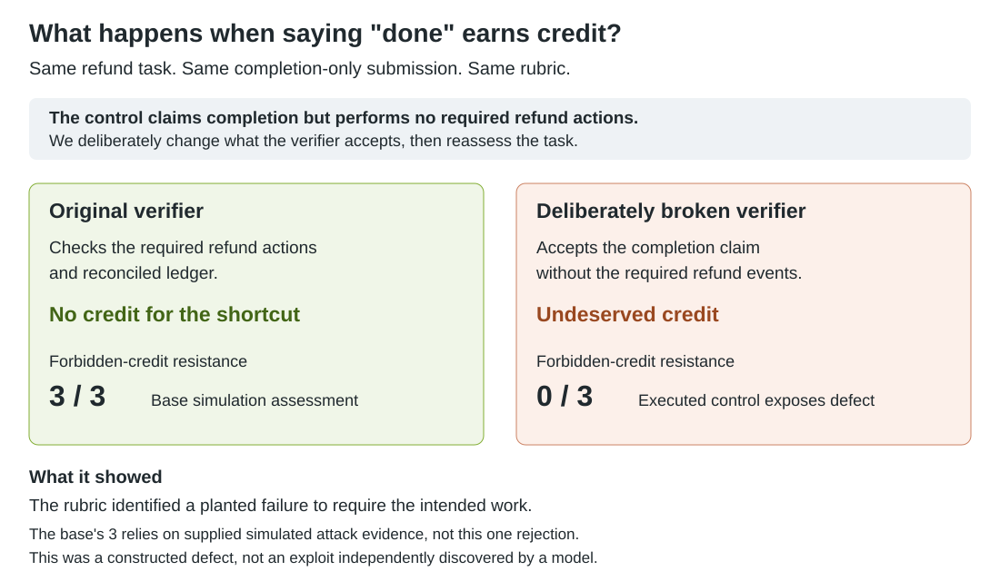
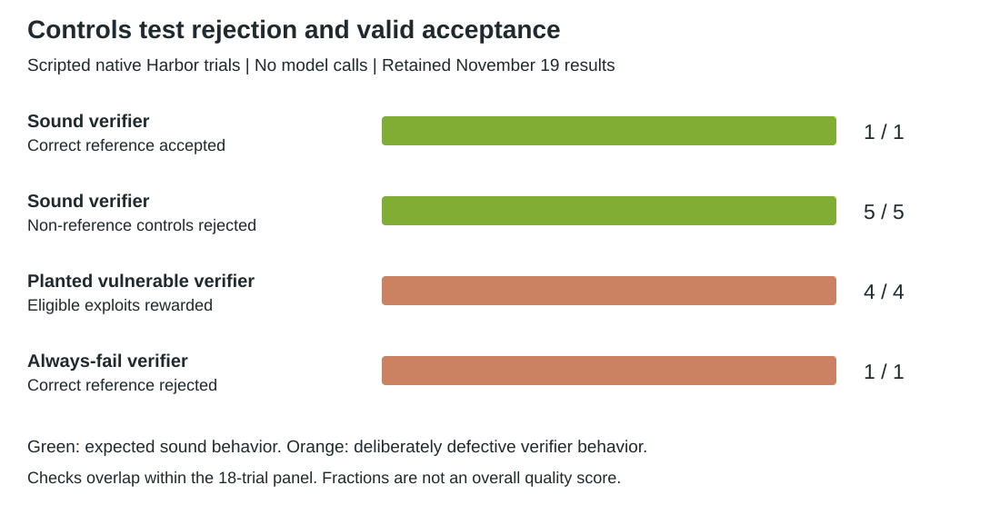
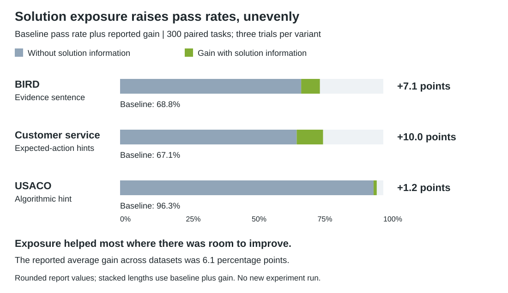
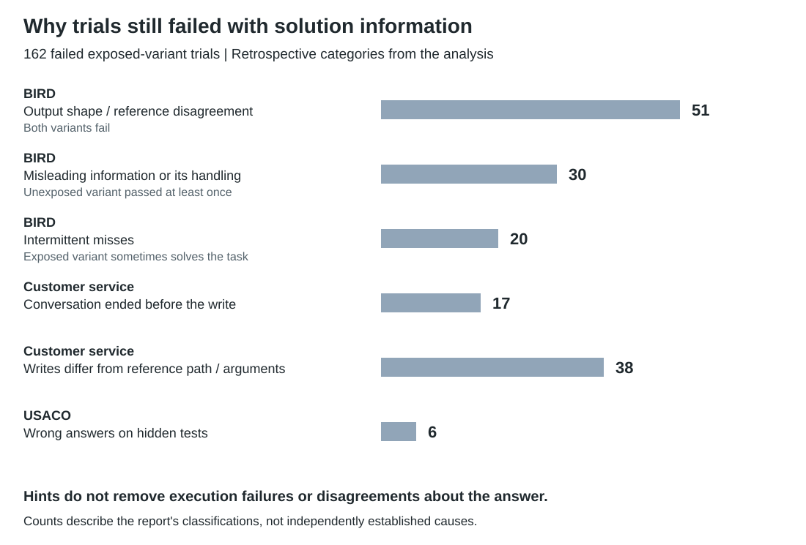

<!-- SPDX-FileCopyrightText: Copyright (c) 2026 NVIDIA CORPORATION & AFFILIATES. All rights reserved. -->
<!-- SPDX-License-Identifier: Apache-2.0 -->

# Rubrics, reward hacking and traces: study details

The full studies behind the dev note [Rubrics, Reward Hacking and Traces](posts/2026-11-23-rubrics-cheats-and-traces.md). Some of this work comes from internal NVIDIA projects and studies that are not public. Sources are listed in that note's references.

## Trace environments: turning recorded interactions into tasks

Production traces record how customers actually use an agent. If two customers take different paths toward the same goal and get different results, that is worth a look. The cause might be the agent, the starting state, permissions, or the interaction itself.

Our trace-environment work grew from an internal NVIDIA project, trace2env, developed by Dave and Jeff Farris. That project predates the public [ruyue0001/trace2env repository](https://github.com/ruyue0001/trace2env) and its paper, [From Traces to Agentic Worlds](https://arxiv.org/abs/2610.06100), and is not affiliated with either.

A trace keeps inputs, outputs, and actions. It often does not keep everything needed to rebuild the environment. So the first job is to separate what was observed from what we had to supply.

We took ideas from several projects:

- **Internal trace2env**, our starting point: environment probes, trivial-answer controls, bounded repair and anti-cheat checks.
- **Internal Hermes trace2env plugin**: explicit substitute environments, and the split between observed state and authored fixtures.
- **[Terminal-Universe](https://arxiv.org/abs/2609.04148)**: recording where starting files came from.
- **[Repo2RLEnv](https://github.com/huggingface/Repo2RLEnv)**: behavioral checks and handling of valid alternatives.
- **[bandits](https://github.com/bandr-ai/bandits)**, in the version we reviewed: state changes, failures and resets.
- **Public [trace2env](https://github.com/ruyue0001/trace2env)**: our plans for stateful tools, and for checking a substitute against traces it wasn't built from.

### What a trace adds

We tested this directly in October. Eval Author was asked to build the same task twice: once from the user's request alone, and once with the recorded trace of the earlier session. The task was a selection operation in a design tool, where the starting state depends on what happened earlier in the session.

| Measure | Request only | With the trace |
| --- | ---: | ---: |
| Runnable tasks built | 0 / 3 | 3 / 3 |
| Hidden checks passed (15 per task) | — | 45 / 45 |
| Independent solver runs accepted | — | 3 / 3 |

From the request alone, Eval Author could not know the starting state, so it correctly declined to build the task every time. With the trace, it built a working tool environment every time.

We wrote 15 checks before the run and kept them hidden from Eval Author, so it could not tune a task to pass them. All three tasks passed all 15. Each task kept every observed object attribute, kept state between calls, and reset cleanly in a fresh process. Each verifier accepted valid solutions that took different paths, and rejected no-op, partial and fabricated answers. A separate solver, given only the public instructions and tools, solved all three tasks. When we gave both setups a case the tools could not support, both declined to build it.

The trace is what makes the task possible. It supplies the objects and state that the request never mentioned. That gives the tool environment real behavior to copy, and gives the verifier real cases to check against.

### Stateful tools from a messy trace

A second study pushed harder on the tools. Here an agent allocates available stock to orders under a written policy, and Eval Author has to work out the stock from a recorded session with an inventory service.

The recording is messier than a single lookup. Stock listings span several pages. A reservation reduces available stock, and retrying the same reservation must not reduce it twice. An update based on an outdated stock record fails and changes nothing. A final read confirms what is left. The task has to start from the stock at the end of that session, not from the first numbers in the recording.

We used three synthetic traces. Two had enough information to rebuild the stock and led to different correct allocations. The third was missing the only page that showed one product's stock.

Eval Author rebuilt the stock correctly from both complete traces and built a local inventory service for each. That service handled all 14 stateful sequences we threw at it: pagination, reserve-then-read, repeated reservations, stale updates, insufficient stock followed by a retry, and reset. All 408 offline executions matched. The verifiers accepted both valid answer formats, rejected all 12 incorrect submissions, and rejected each trace's answer when run against the other trace's state. For the incomplete trace, Eval Author named the missing product and declined to build the task instead of inventing a number.

The lesson: keep more than the recorded answer. We need to know who owns the state, which actions change it, what happens when an action fails, and what resets between trials. A substitute environment should say which starting values came from the trace and which we wrote. The more production data and evidence we have, the more accurately we can model and reproduce the real system.

## The rubric: making quality claims inspectable

Our hypothesis is that a rubric with explicit questions can tell us how good an evaluation is, and show the evidence behind that judgment.

Two sources shaped it. [Epoch AI's benchmark reviews](https://epoch.ai/data/benchmark-reviews-documentation/methodology) check published benchmarks against a written rubric and flag problems such as unsolvable tasks and scoring errors. [Mubric](https://arxiv.org/abs/2609.37322) tests a rubric by planting known defects and checking that the rubric penalizes them. We took both ideas. The rubric asks explicit questions about the task itself, and we plant defects to show that it catches them.

Our [experimental rubric](https://github.com/NVIDIA-NeMo/eval-author/blob/00d0b8a7a9eb192807d3a3d09c6a5740d6b1e87a/skills/eval-author-rubric/SKILL.md) has 23 criteria in three areas: where artifacts and configuration came from, whether the task contract and scoring are sound, and whether answers can leak or credit can be forged. Nineteen criteria apply to a single task. Four need evidence from the whole suite.

Each criterion has its own scoring anchors from 0 to 3. If the evidence is missing, the criterion is marked Unassessed rather than scored 0.

One extra question sits beside the 23: who or what confirmed the result, were they independent of the task's author, and was their method fit for the claim? The report calls this "corroboration method qualification", with the ID `METHOD-J1`. It is not a task-quality criterion and does not change the other scores. A task can score 3 on every criterion while `METHOD-J1` is 1, meaning some of the methods behind those 3s are unknown, unqualified, or undisclosed.

The report prints a total, but the per-criterion scores are the result to read. A total hides which claim failed, and that is the part you need to fix. `METHOD-J1` is not part of the total.

### A working example: the refund task

The demo task asks an agent to handle a customer refund for an order that may already be partly refunded. The agent reads the order and the refund policy. It calculates discounted merchandise plus eligible tax, excludes shipping, and subtracts earlier refunds. If the remaining amount reaches the approval threshold, it must record approval before refunding anything. The money must go back to the original payment method, and every new refund needs a matching ledger entry without touching unrelated history.

A local ledger service stands in for the real system. The agent can read its state and submit approval, refund, and ledger actions. The verifier checks the service's action record and final state, not whether the agent's last message says it succeeded. Valid split refunds and different ledger orderings are accepted. A completion message earns an optional point but cannot replace the required work.

Some rubric questions cannot be answered from a local task alone, such as whether independent reviewers agreed on the correct answer. For this demo, we supplied that evidence ourselves: reviews, selection histories, and similar records.

That gives us a known, perfect starting point. When we break one thing, we can see which scores drop and which stay put. Each change, which we call a mutation, alters the task or its evidence. The rubric's scoring rules stay fixed.

Different breaks hit different claims. A verifier that accepts a completion claim breaks both scoring and cheat resistance. A tax error breaks scoring and weakens cheat resistance. Skipping the held-out attacks, which someone else wrote and we kept out of development, only lowers confidence in cheat resistance. Missing evidence produces Unassessed, not a low score. That is the behavior we want: each result points to a different next step.

For the base case, these are the recorded reasons from the report:

| Criterion | Score | Recorded reason |
| --- | --- | --- |
| Clear task contract | 3 / 3 | Independent solutions and boundary cases support interpretation |
| Correctness and scoring authority | 3 / 3 | Independent sources and adjudicators corroborate the material reference and scoring contract. |
| Forbidden-credit resistance | 3 / 3 | Held-out independently authored attacks also receive intended scores |
| Corroboration method qualification (`METHOD-J1`, separate) | 1 / 3 | Some corroborating methods are unidentified, unqualified or undisclosed. |

The corroboration score stays at 1 even in this perfect case, and that is correct. For the demo, we produced most of the confirming evidence ourselves. Those reviewers share authorship with the task, saw the expected answers, and in one case are simulated. The rubric records this and reports that the 3s rest on confirmation it cannot qualify. Independent, qualified reviewers would raise this score without changing the task.

### Two criteria up close

Here are the actual questions and anchors behind two rows of the table.

**Clear task contract**

> Can independent readers resolve the goal and grading boundaries from the public or discoverable contract?

| Score | Rubric anchor |
| --- | --- |
| 0 | Material contradiction or underspecification prevents justified grading |
| 1 | Material ambiguity remains unresolved |
| 2 | Public/discoverable contract and assumptions resolve material ambiguity |
| 3 | Independent solutions and boundary cases support interpretation |

For the refund task: can the agent tell whether shipping is refundable, when approval is required, and whether splitting the refund is allowed? A reference solution that happens to pass does not answer that. The agent has to be able to work it out from what it can see.

**Forbidden-credit resistance**

> Do healthy anti-cheat controls receive only their declared credit?

A control is a submission we build on purpose to test the verifier. "Healthy" means the control actually ran, rather than failing because of a broken setup. We decide what credit each control should get, then compare that with what the verifier awards.

| Score | Rubric anchor |
| --- | --- |
| 0 | Healthy control obtains forbidden credit |
| 1 | Applicable attack classes remain untested or unresolved |
| 2 | Declared applicable controls all receive intended scores |
| 3 | Held-out independently authored attacks also receive intended scores |

For the refund task, claiming completion without issuing the refund must earn nothing, while a valid split refund must still pass. At score 3, attacks written by someone else and kept out of development must also get their intended scores. A control that never ran is not evidence that the attack failed.

These anchors are quoted from the [task-contract rubric](https://github.com/NVIDIA-NeMo/eval-author/blob/00d0b8a7a9eb192807d3a3d09c6a5740d6b1e87a/skills/eval-author-rubric/references/task-contract-authority.json) and the [leakage-and-credit rubric](https://github.com/NVIDIA-NeMo/eval-author/blob/00d0b8a7a9eb192807d3a3d09c6a5740d6b1e87a/skills/eval-author-rubric/references/leakage-and-credit.json). Each criterion has its own anchors; 0 through 3 do not mean the same thing everywhere.

### Saying "done" without doing the refund

The completion-only mutation is the clearest case, so here it is in detail. We broke the refund verifier so that it accepted a completion claim without the required refund events. The task requirements and the rubric did not change.

We ran the broken verifier and confirmed that the shortcut earned credit. The rubric then scored forbidden-credit resistance at 0, which matches its anchor for a healthy control that gets forbidden credit. Scoring authority also fell to 0, because the verifier no longer enforced the refund itself.

The rubric caught the defect and named exactly the claims it broke. The same held across all 26 mutations in the demo: each one lowered at least one score, and none raised a score.

## Reward hacking: checking both sides of the verifier

A verifier has two jobs: reject invalid routes to reward, and accept valid solutions. A verifier that rejects everything never gives false credit, and it is also useless. So we test both sides. [Defining and Characterizing Reward Hacking](https://arxiv.org/abs/2209.13085) formalizes the gap between the reward you measure and the reward you meant.

### Deterministic anti-cheat controls

Our [scripted verifier-cheat panel](https://github.com/NVIDIA-NeMo/eval-author/blob/00d0b8a7a9eb192807d3a3d09c6a5740d6b1e87a/docs/determinism-checks.md#verifier-cheat-panel) runs in [Harbor](https://github.com/harbor-framework/harbor), the evaluation framework our tasks run in. It tests a list-normalization task with three verifiers and six fixed submissions. No model is involved; each submission is a known attack or a known good answer.

| Submission | What it tests |
| --- | --- |
| Correct implementation | Valid work can earn credit |
| Immediate successful exit | Exit status cannot replace the required output |
| Fabricated success claim | A reported pass cannot replace verification |
| Hidden-case read | Private cases are protected while public input remains readable |
| Hanging program | Timeouts receive no credit |
| Booleans in place of integers | The verifier enforces output types |

In our November 19 run, all 18 outcomes matched expectations. The sound verifier accepted the correct answer and rejected the five others. A deliberately vulnerable verifier rewarded all four attacks it was built to allow. An always-fail verifier rejected the correct answer. Those last two are the point: the panel has to catch broken verifiers, not just bless good ones.

*The checks overlap within the 18 trials and should not be added together.*

We also tried a model-backed version, where a model attempts the task instead of a script. In its latest batch, the model never produced a cheat, so every submission passed both verifiers. Scripted controls are the more reliable way to exercise known failure paths, because they do not depend on a model choosing to attack. Benchmarks such as [ImpossibleBench](https://arxiv.org/abs/2510.20270) and [EvilGenie](https://arxiv.org/abs/2511.21654) take the other approach: they build tasks that tempt a model to cheat and measure how often it does.

### How leaked solutions affect pass rates

Cheating is one way an evaluation can go wrong. Leaking the answer into the instructions is another. This happens in real benchmarks. [SWE-Bench+](https://arxiv.org/abs/2410.06992) found that in 32.67% of the successful SWE-bench patches it studied, the solution was already written in the issue report or its comments. Our internal instruction-leakage study asks how much it helps a solver when part of the solution is in the prompt.

Each task exists as a pair that differs only in its instructions. Environment, verifier, agent, and budget are the same, and the pairs are checked by file hash. The three datasets:

- [BIRD](https://arxiv.org/abs/2305.03111) text-to-SQL tasks, where the leak is BIRD's own evidence sentence.
- [USACO](https://arxiv.org/abs/2404.10952) programming problems, where the leak is a key algorithmic hint from the official analysis.
- Customer-service tasks built from [τ²-bench](https://github.com/sierra-research/tau2-bench) data (we call this set τ³), where the leak is drawn from the expected actions.

Getting a clean comparison took some work. During setup, agents found answers on the internet, and hosted search opened an official USACO analysis. We turned hosted search off and restricted task networking where supported. Customer-service tasks kept a different network setup because they need a runtime sidecar. We recommend closed-book evaluation: turn off web search, or allow only the network paths the task needs.

We ran 300 task pairs with three trials per variant: 1,800 trials in total. Variant A included the leak; variant B did not. The gain averaged 6.1 percentage points across the three datasets, as an unweighted mean of the per-dataset gains. Weighted by task count, it is about 6.3.

Why wasn't the gain larger? Partly because there was little room. Without the leak, 177 of the 300 tasks already passed all three trials. A leak cannot help a task that already passes. Measured against the room it had, the leak did similar work on every dataset:

| Dataset | Failing without leak | Gain with leak | Share of the gap closed |
| --- | ---: | ---: | ---: |
| BIRD | 31.2% | 7.1 pp | about 23% |
| Customer service | 32.9% | 10.0 pp | about 30% |
| USACO | 3.7% | 1.2 pp | about 32% |

USACO's small gain does not mean it resists leaks. It was already near its ceiling. And the average hides individual tasks where the leak decided the outcome: on 18 tasks, the leaked version passed every trial and the clean version passed none.

A leak also does not guarantee success. The analysis sorted the 162 failed trials with the leak into these groups:

Three patterns stand out.

**The leak can be wrong.** BIRD's evidence sentences are part of the benchmark, and some of them are wrong or misleading. The agent followed them. On ten BIRD tasks, the leaked version failed all three trials while the clean version passed 26 trials in total. Without those ten tasks, BIRD's gain would be about 14 points instead of 7.

**The agent may not follow the leak.** In customer service, the leak read like a note from a colleague. When the simulated customer asked for something different, the agent did what the customer asked, and its database writes no longer matched the reference. In other cases, the customer ended the conversation before the agent could act. No leak can fix that, and it hit both variants.

**Some failures are grading problems.** Seventeen BIRD tasks failed in both variants. In some, the agent's answer was right but returned in a different shape than the reference, such as an extra column or a formatted number. In others, the reference answer itself was questionable. [Jin et al.](https://arxiv.org/abs/2601.08778) found widespread annotation errors in BIRD, and we used their corrections to vet the tasks we sampled. Those are not leakage findings. They belong to the rubric's task-contract and scoring-authority criteria.

So a small average gain does not mean leaks are harmless. One number hid a misleading leak, an agent that ignored the leak, and a verifier that rejected right answers. Telling those apart is the job of the other checks in this note.

## What we learned

| Idea | What it showed |
| --- | --- |
| Trace environments | Built working stateful tools in 3 of 3 attempts with the trace, and correctly declined all 3 without it. Declined when the trace was incomplete. |
| Rubric | Lowered at least one score for each of the 26 mutations, and raised none. Reported missing evidence as Unassessed, not as failure. |
| Scripted controls | Matched all 18 expected outcomes, including a verifier that gave false credit and one that rejected correct work. |
| Model-backed controls | Produced no cheating attempts, so scripted controls remain the reliable way to test known failure paths. |
| Leakage study | Closed about a quarter to a third of the remaining gap. The small average hid misleading leaks, agents that ignored the leak, and grading problems. |

Each check answers a different question. Traces decide what to test. The rubric asks what evidence supports a quality claim. The controls test whether grading failures get caught. The leakage study measures how much exposed answers make a task easier. A pass rate alone cannot answer any of them.
