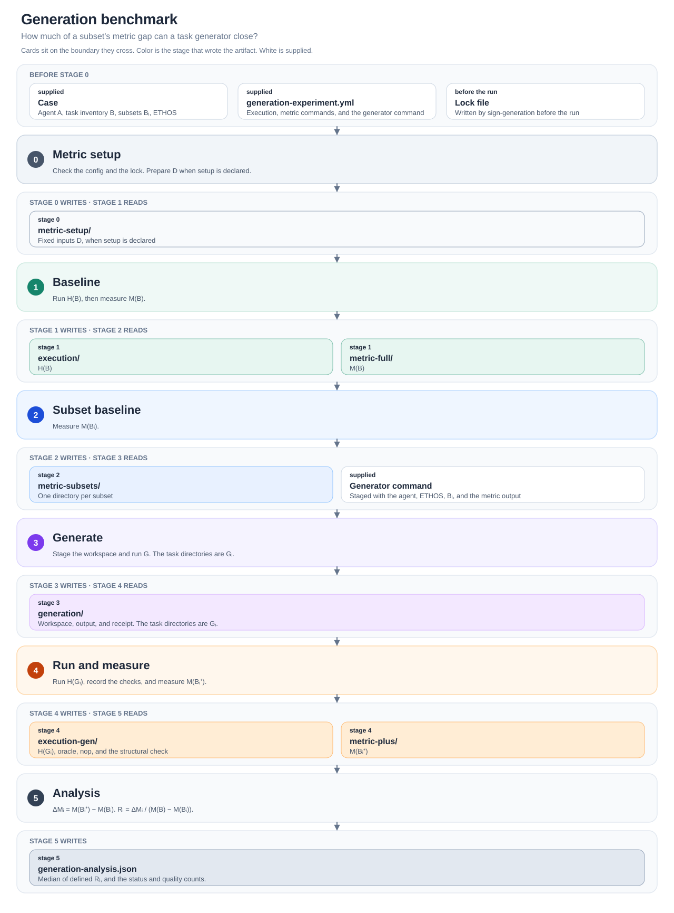

<!-- SPDX-FileCopyrightText: Copyright (c) 2026 NVIDIA CORPORATION & AFFILIATES. All rights reserved. -->
<!-- SPDX-License-Identifier: Apache-2.0 -->

# Architecture

## Question

**How much of a subset's metric gap can a task generator close?**

You supply prepared case examples, plus generator and metric commands. Each case reports `Rᵢ` for its subsets, then the median of the defined `Rᵢ` values. [Cases](#cases) defines a case. [Flow](#flow) is the stage order. [Benchmark format](benchmark-format.md) explains the YAML. Symbols are in [notation](#notation).

## Cases

A case is one prepared example: eval agent `A`, task inventory `B`, that case's predefined subsets, and the case's ETHOS and the settings its commands read. Subsets stay inside the case. One experiment is a list of cases under one generator command and one metric scoring command. The stages run for each case.

Preparation stays outside the six stages. The experiment consumes the prepared cases.

`cases/case-NNNN/` in the work root holds that case's stage outputs. `NNNN` is the case's zero-based index position in `cases.yml`. The `case_id` string in `cases.yml` is the identity. The prepared case directory is read-only and stays outside the work root.

## Invariants

1. **`B` is read-only.** No stage writes into the case directory. Each stage's own output is immutable: a later stage consumes it and writes only its own directory. Refer to the [stage contract](stages.md#stage-contract).
2. **Subsets never mix.** One subset's workspace, logs, `execution-gen/`, and metric results live under that subset. The same task id can appear in two subsets. Nothing is merged into the case inventory or the baseline results.
3. **`G` must see only its subset.** The staged workspace contains the agent, ETHOS, and `Bᵢ`. The request names the path of that subset's stage 2 metric output, and `G` reads that directory in place. The orchestrator does not stage held-out tasks, `M(B)`, `H(B)` outside `Bᵢ`, other subsets, or host measurement trees. The metric output must not name held-out tasks.
4. **One metric per case.** Stage 0 calls `metric.setup.command` if it is declared. Stages 1, 2, and 4 call `metric.score.command` on the same `metric-setup/`, or on the trials alone when setup is absent.

## Generated tasks

`Gᵢ` is every directory `G` wrote under `output/tasks/`.

Stage 4 runs a structural check, `oracle`, `nop`, and `A` on `Gᵢ`. The check and the recorded outcomes are in [stage 4](stages.md#stage-4-run-and-measure). Those outcomes are quality counts for `G`. The `A` trials that have a trajectory are `H(Gᵢ)`.

## Flow

`run_generation_experiment.py` runs these stages in order. Cases are independent. How a stage error affects the rest of the run is TBD. [Stages](stages.md) is the contract, including when a finished stage is skipped, how `--invalidate-stage` removes one, and what `--case` skips.

0. **Metric setup.** Check config schemas and the lock. Run `metric.setup.command` if it is declared.
1. **Baseline.** Run `H(B)`, then measure `M(B)`.
2. **Subset baseline.** Measure each subset `M(Bᵢ)` from those trials.
3. **Generate.** When `M(B) = M(Bᵢ)`, record `zero_gap` and do not run `G`. Otherwise stage the workspace and run `G`. The request names the stage 2 metric output. The directories under `output/tasks/` are `Gᵢ`.
4. **Run and measure.** Run the structural check, `oracle`, `nop`, and `A` on `Gᵢ`. Record the outcomes. Measure `M(Bᵢ⁺)`.
5. **Analysis.** Write `generation-analysis.json`.



## Command invocation

The orchestrator runs `metric.setup.command`, `metric.score.command`, and `generation.command` the same way. Each runs as a subprocess in its invocation directory, with its `timeout_seconds`:

```text
<command…> --request request.json [--workspace workspace] --output-dir <output>
```

`--workspace` is optional. Setup omits it. Score and generation pass it.

Each invocation directory holds `request.json`, `workspace/` when the command receives one, and `receipt.json`. Score and generation also hold `output/`, and `<output>` is `output`. Setup's invocation directory is `<work_root>/cases/case-NNNN/metric-setup/`, `<output>` is `.`, and that directory is `D`. It holds `request.json` and `receipt.json` beside the files the setup type names. The setup type does not declare those two files.

`request.json` names the invocation's inputs. `workspace/` holds staged inputs. The orchestrator hashes `workspace/` before the command starts and again after it exits, including after a timeout or a failure. A difference records the invocation as `unavailable` with the reason `workspace_modified`, and the output is not published. The output directory is the only directory the command writes. The orchestrator checks it against the declared type. At `timeout_seconds` it signals the process group, waits 60 seconds, then kills it. A setup failure is a stage error at stage 0. A score failure is a stage error at stage 1 and marks the subset `unavailable` at stages 2 and 4.

Setup's request names the case's files by absolute path. Score's `workspace/` holds `trials/<task_id>/` copies of the trials for one task set. Its request names the absolute path of `metric-setup/` when setup is declared, and lists the task set and each trial's `task_id` and workspace path. Its output directory holds `score.json` and any other files. Generation's `workspace/` is the staged workspace under [generator contract](#generator-contract), and its output directory is the generator output. Score reads `metric-setup/` in place when setup is declared. Generation reads the stage 2 metric output in place.

## Host Harbor jobs

Each job is one agent. `A` writes `agents/agent/`. `oracle` writes `agents/oracle/`. `nop` writes `agents/nop/`. The run id is `<name>/run-0001`. Harbor 0.24.0 runs these jobs on the host.

```text
stage_1:
    harbor A on B
        agents/agent
    → measure M(B)
stage_3:
    M(B) = M(Bᵢ)?
        yes → zero_gap
        no  → stage the workspace
            → run G
            → Gᵢ
stage_4:
    ( structural check ‖ harbor oracle ‖ harbor nop ‖ harbor A ) on Gᵢ
        agents/oracle
        agents/nop
        agents/agent
    → record outcomes
    → measure M(Bᵢ⁺)
```

The job root for stage 1 is `cases/case-NNNN/execution/`. The job root for stage 4 is `cases/case-NNNN/execution-gen/<subset-dir>/execution/`. The stage writes `results.json` and `execution.json` in that directory. Trial paths in the rows are relative to `results.json`. Later stages resolve trial directories from that file's parent.

## Host measurement

Stages 1, 2, and 4 run `metric.score.command` on the trials for one task set. The request names `metric-setup/` when setup is declared, and the command reads that directory in place. The invocation follows [command invocation](#command-invocation). It writes `score.json` and its other output under `output/` in that stage's metric directory. The request that stage 3 writes names the stage 2 output directory for that subset. The [metric contracts](#metric-contracts) define what the command reads and writes. The metric-command receipt is in the [stage contract](stages.md#stage-contract).

## Metric setup

Stage 0 checks the experiment config and the lock. A failed check is a stage error.

If `metric.setup` is declared, the stage then runs `metric.setup.command`. The invocation prepares `D`, the metric's fixed inputs, and writes them to `metric-setup/`. The orchestrator then checks that directory against the type declared in `metric.setup.output`. See [metric contracts](#metric-contracts). With no `metric.setup`, there is no `metric-setup/`.

## Generator contract

The orchestrator runs this command under the [command invocation](#command-invocation) contract, with its working directory at `generation/<subset-dir>/`.

The command may start sidecars, including containers, and stops them before it exits. The orchestrator does not configure those sidecars and does not sandbox the command.

`request.json` has schema `nemo.eval_author.generation_request.v1`. It carries the subset id, the `Bᵢ` task identities, the workspace paths, the path of the subset's stage 2 metric output, `A`'s `agent_bundle_id` and the `harbor` block from `agent.yml` with `{input:…}` templates unresolved, a copy of `generation.settings`, and `max_gaps` when the run flag is set. It contains no held-out task ids and no `B`-level scores.

The staged workspace is:

```text
ETHOS.md
agent/                  # after agent_source_excludes
tasks/<task_id>/        # Bᵢ
```

Copies skip the [skipped names](benchmark-format.md#skipped-names). Prefixes in `agent_source_excludes` are left out of `agent/`.

`output/` contains `tasks/<slug>/`, `logs/attempts.jsonl`, `logs/<slug>/`, and `response.json` (schema `nemo.eval_author.generation_response.v1`). The response lists each attempt, the gaps left unattempted, and an error string or null.

The generation receipt records the request digest, the configuration digest, the output file manifest, the attempt summary, and a status. `configuration_sha256` covers the `generation` lock entry and the implementation digest. Status is `complete` when the command exits 0, `partial` on a timeout or a non-zero exit with `response.json.error` null, and `unavailable` on a launch failure, a missing or invalid response, a non-null error, or a changed workspace (`workspace_modified`). A published directory is reused only when the request digest, the configuration digest, and the output manifest match. The attempt summary and the status are output data, not reuse keys. To retry, delete that subset directory.

## Models and validators

A typed model parses every config and every artifact the orchestrator reads: the experiment and case configs, `request.json`, `response.json`, and `generation-analysis.json`. The models are in `generation_benchmark/models.py`. They follow the metric benchmark's `models.py`. The models also mark each field as an identity field or not, which sets what the [lock file](benchmark-format.md#lock-file) hashes. Unknown fields are rejected, types are strict, a digest matches `sha256:<64 hex>`, and an evidence path is relative, with no traversal and no symlink.

A validator checks an output against its models and the files it names. The validators are in `generation_benchmark/validation.py`, after the metric benchmark's `validation.py`. They cover a generator's `output/` directory and the stage 4 structural check. A failure names the case, the subset, and the path. A command author runs the same validators on a command's output before an experiment.

## Metric contracts

Two directories pass data between user commands, by path: `metric-setup/`, when `metric.setup` is declared, from `metric.setup.command` to `metric.score.command`, and the metric output from `metric.score.command` to `G`. The orchestrator owns the stage inputs and the directory slots. The user owns what the directories contain, `U`.

The user declares each `U` as a Pydantic type that subclasses `DirectoryModel` from `generation_benchmark/models.py`. The type has a `load(directory)` classmethod that reads the declared files and raises on a missing or invalid one. Files the type does not name, such as logs, are ignored. `metric.setup.output` declares the type for `metric-setup/`, and is required when `metric.setup` is declared. `metric.score.output` declares the type for the metric output. It extends `ScoreOutput`, which loads the required `score.json`, and is `ScoreOutput` itself when omitted. A reader has no declaration of its own. `metric.score.command` reads `metric-setup/` as the setup type, and `G` reads the stage 2 metric output directory as the score type. The command and the generator can call the same `load`, so their types check them during development.

Every user-supplied invocation runs in a subprocess with a timeout: `metric.setup.command`, `metric.score.command`, the generator, and `load`. `load` runs under its declared interpreter. It checks `metric-setup/` after stage 0 when setup is declared, the metric output after stages 1, 2, and 4, and the stage 2 metric output before stage 3 runs `G`. A failed check at stage 0 or 1 is a stage error. At stages 2, 3, and 4 the subset is `unavailable`, with the validation message as the reason. The message names the case, the subset, and the path. The metric author keeps held-out task names out of the metric output (invariant 3).

## Work root

Run `run_generation_experiment.py --benchmark generation-experiment.yml --run-id <id> --work-root <dir>`. `--benchmark` names the experiment file. `--run-id` identifies the run and must stay the same when a work root is reused. `--work-root` is the output directory. Keep it outside the experiment directory and outside Git, with one writer per directory.

```text
<work_root>/
  generation-inputs.json
  cases/case-NNNN/
    metric-setup/                   # stage 0, if metric.setup is declared: D, plus request.json and receipt.json
    execution/                      # H(B)
    metric-full/                    # M(B): request.json, output/, receipt.json
    metric-subsets/                 # M(Bᵢ): subset-NNNNNN/ per subset, each with request.json, output/, receipt.json
    generation/<subset-dir>/        # request.json, workspace/, output/, receipt.json
    execution-gen/<subset-dir>/     # H(Gᵢ), oracle, nop, and the structural check
    metric-plus/<subset-dir>/       # M(Bᵢ⁺): request.json, output/, receipt.json
  generation-analysis.json
```

`NNNN` is the case's position in `cases.yml`. See [Cases](#cases). `<subset-dir>` is the `subset-NNNNNN` directory written for that subset under `metric-subsets/`. `generation-inputs.json` records the run id, the implementation digest, and the lock entries the run read. The [lock file](benchmark-format.md#lock-file) sits beside the experiment file. A different `--run-id` needs a new work root. A changed pin invalidates the stages that recorded it, as described in the [stage contract](stages.md#stage-contract). The case directory is outside the work root and is never written.

[Stages](stages.md) lists which stage writes each entry.

## Deferred

- **Leak checks** on generated tasks, logs, and transcripts.
- **Audits derived from `H(B)` traces.** Currently the `tool_calls` `D` comes from the items file, but it could be derived from `H(B)` traces.
- **Parallel subsets.** A later runner can start more than one subset. Each subset already has its own directory.
- **Case directory names.** A later layout names the case directory from `case_id` instead of the list index.
- **Command isolation.** The orchestrator does not sandbox a command. What the command can read beyond its workspace and the paths it is given is the command's responsibility.
- **Semantic methods.** `capabilities` and `failure_cases` need per-trace judgments that a frozen `D` cannot hold.
- **Tools outside `D`** (`tool_calls`). Names measured on `B` or `Bᵢ⁺` that `D` does not list. Counting those names is a later report. `M` and `R` stay as computed from `D`.
- **MCP server whitelist.** The structural check records every `mcp_servers` entry. A later config names the servers a task may declare, including a sidecar the user supplies. The check then allows those entries and records any other.
- **Granular retries.** `--invalidate-stage` works per stage, and with `--case` per case. A later flag could retry one subset, or one task in stage 4, without deleting directories by hand. A later filter could retry by status, such as `agent_error`.
- **Unsigned iteration.** The metric benchmark's `--allow-unsigned` runs without SHA pins while iterating, and still verifies any supplied pins. The generation benchmark has no equivalent. `sign-generation` writes the lock, and stage 0 fails on a missing lock or entry. A later `--allow-unsigned` would run without the lock and still verify the entries that exist.
- **Default Eval Author plugins.** The reference implementation is the only metric and generator that works with Eval Author. A later change adapts it into default plugins that an experiment can name, instead of carrying the reference settings.

## Notation

| Symbol | Meaning |
| --- | --- |
| `A` | The eval agent |
| `B` | The task inventory |
| `Bᵢ` | A predefined subset of `B` |
| `Bᵢ⁺` | `Bᵢ ⋃ Gᵢ` |
| `G` | The task generator |
| `Gᵢ` | Every directory `G` wrote for `Bᵢ` under `output/tasks/` |
| `H(X)` | Harbor trials of `A` on task set `X` |
| `D` | The metric's fixed inputs. Stage 0 prepares them; common to every measurement |
| `M(X)` | The metric score for `H(X)`. `M(B)` abbreviates `M(H(B))` |
| `ΔMᵢ` | `M(Bᵢ⁺) − M(Bᵢ)` |
| `Rᵢ` | `ΔMᵢ / (M(B) − M(Bᵢ))` |
