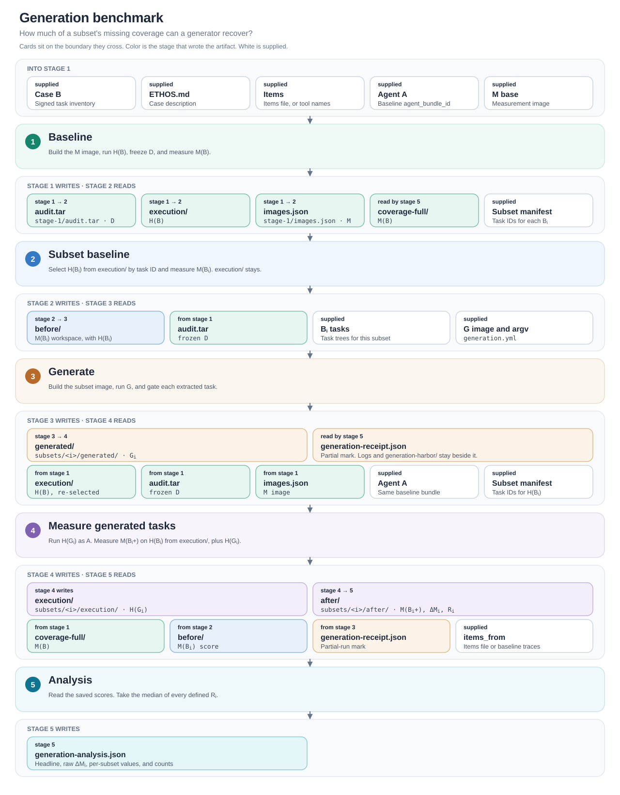

<!-- SPDX-FileCopyrightText: Copyright (c) 2026 NVIDIA CORPORATION & AFFILIATES. All rights reserved. -->
<!-- SPDX-License-Identifier: Apache-2.0 -->

# Architecture

## Question

The benchmark asks: **how much of a subset's missing coverage can a generator recover?**

The benchmark takes an audit of the agent tools, a set of Harbor tasks, and the
defined subsets of that set. It measures `tool_calls` coverage of the set and of
each subset against that audit. For each subset, the task generator G runs in an
isolated container and writes new tasks intended to close that subset's coverage
gaps. The benchmark runs those tasks with the eval agent and measures the subset
again with the new evidence added. It reports Rᵢ, the fraction of coverage gap
that the generated tasks recovered.

The experiment has five stages. Each has a CLI and a completion receipt.
[Stages](stages.md) gives the contract and each stage's inputs, outputs, and
completion rules. The YAML definition is in
[benchmark format](benchmark-format.md).

## Notation

| Symbol | Meaning |
| --- | --- |
| B | Signed task inventory of the case |
| Bᵢ | Predefined subset i, from `eval_subsets` |
| G | The task generator |
| Gᵢ | Tasks G generates for subset i |
| Bᵢ⁺ | Bᵢ ∪ Gᵢ |
| A | The eval agent under test |
| C | The coding agent G drives, for example Codex |
| H(X) | Harbor trials of A on X |
| H(Bᵢ⁺) | H(Bᵢ) ∪ H(Gᵢ). H(Bᵢ) is a slice of H(B), and only Gᵢ is executed |
| D | Audit item list (the coverage denominator), rendered once |
| M(X) | `tool_calls` coverage of H(X) against D |
| ΔMᵢ | M(Bᵢ⁺) − M(Bᵢ) |
| Rᵢ | ΔMᵢ / (M(B) − M(Bᵢ)) |

## Invariants

1. **B is read-only.** No stage writes into the case directory. B is the full
   prepared task inventory. Each stage's own output is likewise immutable: a
   later stage consumes it and writes only its own directory. See the
   [stage contract](stages.md#stage-contract).
2. **D is fixed.** One render produces `audit.tar`. Every M container and every G
   subset image unpack it at the same root, so `sources[].path` and
   `binding.artifacts` resolve without rewriting. The recorded `sources[].sha256`
   still matches those bytes. No later stage renders D again.
3. **Subsets never mix.** Gᵢ lives only under `subsets/<i>/generated/`, and H(Gᵢ)
   only under `subsets/<i>/execution/`. The same task ID may appear in two
   subsets without conflict. Nothing is merged into the case inventory, the
   baseline results, or a run-wide ID list.
4. **G sees only its subset.** A G image contains D, Bᵢ, H(Bᵢ), the M(Bᵢ)
   tree, and A's source tree. It never contains M(B), the full-inventory report,
   other subsets' files, or a path to the host case. D is the full tool
   denominator, so G sees every tool item, including tools only a held-out task
   exercises. Held-out instructions, solutions, and directories stay out of the
   image. `ETHOS.md` can describe a behavior that a held-out task tests. A Bᵢ
   README or the case description can name other tasks when the author wrote
   them there. Known gap: task trials have open egress (see [Network](#network)).
5. **Harbor has one entry point.** H(B), H(Gᵢ), and G's own trials all go through
   the Harbor adapter.
6. **M and G are pinned separately.** Each has its own image digest and its own
   eval-author pin. Both pin the same Harbor version. A run's identity is that
   image digest, the digest of its input tar, and the in-container argv.
7. **D does not see scores.** Rendering never reads scores or reports. In
   `baseline_traces` mode it reads only the tool names in H(B).
8. **Only `tool_calls` is measured.** The benchmark loader rejects any other
   method and any non-`tool` item. Semantic methods need per-trace model
   judgments that depend on H(Gᵢ), and a frozen D cannot hold them.

## Flow

Legend: `→` sequential, `‖` parallelizable, `?` conditionally executed, `[ per X ]` for each.

```text
stage_1:
    build_m_base
    → ( H(B) ‖ render_audit? )          # render_audit iff items_from = items_file
    → derive_audit?                     # iff items_from = baseline_traces
    → freeze_audit
    → M(B)                              # fresh M container
stage_2:
    ‖ [ per Bᵢ ]
        select H(Bᵢ) from H(B)          # by task ID; execution/ stays
        → M(Bᵢ)                         # fresh M container
stage_3:
    build_g_base                        # once
    → ‖ [ per Bᵢ ]
        build_g_subset_image            # G base + audit + Bᵢ + H(Bᵢ) + M(Bᵢ) + A
        → open_session                  # scoped adapter token
        → run_G                         # no mounts, relay network
        → extract /output, /logs        # also after timeout or non-zero exit
        → close_session                 # revoke, wait until jobs stop
        → gate_per_task
stage_4:
    ‖ [ per Bᵢ with Gᵢ extracted ]
        H(Gᵢ)                           # stage 4 runs Harbor in subsets/<i>/execution/
        → M(Bᵢ⁺)                        # fresh M container: D + H(Bᵢ) + H(Gᵢ)
        → ΔMᵢ, Rᵢ
stage_5:
    analyze_generation                  # generation-analysis.json, including tools outside D
```

Exactly one audit source runs. `render_audit` runs only for `items_file`, and it
may start with H(B). `derive_audit` runs only for `baseline_traces`, and it waits
for H(B). `freeze_audit` runs once, on whichever source ran, and M(B) follows it.

Subset bodies do not depend on each other, so each fan-out is `‖ [ per Bᵢ ]`.
The reference orchestrator runs them one at a time. A parallel runner needs no
change to the layout.



[Open the SVG diagram](assets/stages.svg).

## Container runner

Rendering, every M, and every G run through one shared container runner.

- It builds an image from a digest-pinned base plus copied-in files. There are
  no bind mounts and no Docker socket.
- It runs a pinned in-container argv with an explicit environment and no
  inherited host variables.
- It extracts only the declared output paths as a tar stream and discards
  everything else. Extraction runs after a clean exit, a non-zero exit, or a
  timeout stop, so partial output survives.
- Input tars are canonical: sorted entries, a fixed mtime, and normalized uid,
  gid, and mode. Their digest is stable across rebuilds of the same inputs.
- Process identity is the image digest, the digest of the input tar, and the
  in-container argv. It does not depend on host paths.

Locally built images have no registry digest. The receipt records the image ID,
and reuse fails closed if that ID is gone, for example after `docker prune`.

## Images

| Image | Contents | Used by |
| --- | --- | --- |
| M base | User's Python base, pinned `eval-author-audit` scripts and requirements, and the generation-only coverage adapter | Rendering D, every M |
| G base | User's C base image, pinned `eval-author`, `eval-author-task-create`, `eval-author-audit`, and `eval-author-environment` skills, a pre-warmed uv cache with `UV_OFFLINE=1`, a Python 3.12+ venv at `/opt/harbor-real` with `harbor==<harbor_version>` off `PATH`, the `harbor` shim first on `PATH`, and the reference G entrypoint | Every G |
| G subset image | G base plus `audit.tar`, Bᵢ, H(Bᵢ), the M(Bᵢ) tree, and A's source tree | One G run |

The user supplies both bases the same way: an image digest, or a Dockerfile that
the user builds once and pins by the digest the build produces. The M base must
already contain a Python that can run the pinned `eval-author-audit` scripts. The
C base must already contain C. The orchestrator does not install Codex.

The G-base build warms the uv cache by resolving every inline-metadata
script and `--with-requirements` file the bundled skills invoke. G runs offline
with `UV_OFFLINE=1`. A script that needs a package not in the cache fails. That
is a G-base build bug, not a generation outcome.

## In-container layout

M and G share one root, so a tree written by M can be copied into G unchanged.

```text
/workspace/
  ETHOS.md                              # at the path audit sources[] names
  .eval-author/audit.md                 # frozen D
  .eval-author/judgments.json           # {} (tool_calls only)
  .eval-author/traces/<task_id>/...     # Harbor trial trees (M input)
  .eval-author/measurements/...         # measure.py output
  .eval-author/audit-coverage-report.json
  .eval-author/audit-coverage-report.md # when the audit produced one
  .eval-author/.working/environments/<agent-slug>/  # proven kit, when the case has one
  tasks/<task_id>/                      # Bᵢ (G image only)
  agent/                                # A's source tree (G image only)
  .eval-author/tasks/<slug>/            # task-create drafts (G writes)
/output/                                # G's declared output
/logs/                                  # G's declared logs
```

The M container for M(Bᵢ⁺) puts H(Bᵢ) and H(Gᵢ) traces side by side in
`.eval-author/traces/`. The per-task gate rejects a Gᵢ ID equal to a Bᵢ ID, so
IDs cannot collide within one container.

## Harbor adapter

The Harbor adapter is a host process that runs Harbor. G's container has no
Docker socket. The stage CLIs call this same process, so one Harbor and one
slot pool serve every run. At startup the adapter checks
`importlib.metadata.version("harbor")` against the benchmark's `harbor_version`,
as the metric benchmark's execution stage does. The stage CLI chooses the
directory for H(B) and for H(Gᵢ).

It listens on two ports. The stage CLIs use the **admin port**, which binds
loopback only. The relay never forwards to it. The **job port** is the only
port the relay forwards.

| Port | Endpoint | Purpose |
| --- | --- | --- |
| admin | `POST /sessions` | Body: a session key. Idempotent on that key. Returns `{session_id, token}`. |
| admin | `DELETE /sessions/{session_id}` | Record the session as deleting, revoke the token, cancel its jobs, and return after those jobs have stopped. |
| admin | `POST /runs` | Body: a Harbor job configuration, including `jobs_dir`. The adapter runs that job in `jobs_dir` and returns when it finishes. |
| job | `POST /jobs` | Body: one task bundle tar plus `{name, agent, model?, options, harbor_version}`. Idempotent on the session id plus `name`. |
| job | `GET /jobs/{name}` | Status and exit code. |
| job | `GET /jobs/{name}/artifacts` | Scrubbed tar of that trial or job directory. |

The job port cannot call `POST /runs`, and a job-port request cannot name a host path.

- **Sessions.** `POST /sessions` is idempotent on the session key. The stage CLI
  sets that key to the subset directory. A live session for that key returns its
  id and token, including a session marked deleting. After the session is
  closed, the same key can be opened again. A rerun opens by the same key,
  deletes the session it gets back, stops that subset's G container and relay,
  and starts fresh.
- **Close.** `DELETE` writes the session as deleting, with the session key and
  the job ids, before it cancels. That record is on the adapter's disk. The call
  returns only after that session's jobs have stopped. A repeated `DELETE`
  continues the same cancel. After the adapter process restarts, it resumes
  every session that is deleting or still open.
- **Token.** The token travels in the `Authorization` header, not the URL. A
  token sees only its own session's jobs. There is no endpoint that lists jobs
  or trials.
- **`POST /jobs`.** Idempotent on the session id plus `name`. The lookup and
  the insert are one check, and the check requires the session to still be
  open. A repeated `POST /jobs` with the same key and the same bundle digest
  returns the existing job. The same key with a different digest is rejected. A
  shim that crashes after submitting re-posts the same name, so nothing runs
  twice. A job cannot start on a session that `DELETE` has already revoked.
- **Version check.** The adapter rejects a request whose `harbor_version`
  differs from its own. Task checksums computed on the shim side then match
  the adapter's.
- **Agents.** These checks keep each Harbor trial on the experiment the
  benchmark pinned: baseline `agent_bundle_id` with the model and trial config
  in `agent.yml`, or Harbor's built-in `oracle` and `nop`. The shim accepts
  `-a` only for those three names and forwards that string. Any other name is
  rejected before submission. The adapter accepts only those three names in a
  job's `agent`. When `agent` is `agent_bundle_id`, an omitted model or trial
  config is filled from `agent.yml`. A supplied model, kwargs, or other field
  that `agent.yml` pins must match it. A difference is rejected before Harbor
  starts, and the rejection names the pinned model. A measurement job names A
  in its Harbor configuration, and Harbor loads that class in the adapter
  process. Agent configs and model credentials stay on the host.
- **Bundle validation.** Harbor runs the bundle on the host. These checks keep
  the task from using that run to reach the host. The adapter rejects a bundle
  that contains any of:
  - `environment/docker-compose.yaml` (or `.yml`). A compose file can mount a
    host path, join a network, or add privileges.
  - `${…}` templates in `[environment].env`, `[verifier]`, or `[solution]` of
    `task.toml`. A template asks Harbor to copy a host environment value into
    the task.
  - `mcp_servers`. An MCP server entry names a server or command on the host.
  - a prebuilt `docker_image`. That field names an image that already exists
    on the host.

  The session token is a separate check. G already holds it. The adapter
  rejects a bundle that contains the token, so the adapter credential stays
  out of the task Harbor runs and later packs into artifacts.

  It never accepts a host path or a shell command. Either one names something
  on the host. It never accepts an arbitrary agent config. That config can
  carry the same host references, and it would replace the agent the benchmark
  pinned.
- **Scrubbed environment.** Harbor runs with an explicit environment: the
  agent's own variables and nothing else from the adapter's process. A `${…}`
  template can expand only those variables.
- **Folder names.** The bundle tar's top directory is the basename of the task
  path the client used. The adapter unpacks it under that same name, so
  Harbor's trial names (`<task>__<suffix>`) match what a local run produces, and
  globs such as `task__*/result.json` still match.

**Measurement.** Stage 1 and stage 4 build the metric benchmark's Harbor job.
`jobs_dir` is `<directory>/agents/agent-0000` and `job_name` is `run-0001`. The
tasks use their case-relative paths, and the agent is A. `<directory>` is
`execution/` for H(B) and `subsets/<i>/execution/` for H(Gᵢ). The stage CLI
passes that configuration to `POST /runs` before Harbor starts. Harbor writes
the tree there, and the tree stays there. The task paths in `result.json`
stay the paths the job was given. A shared module in the stage CLIs builds this
configuration.

**G jobs.** A job-port request runs one task in an adapter scratch directory.
The shim's `trial` and `job` calls are `harbor trial start` and `harbor run`.
The adapter returns a scrubbed tar. Stage 3 copies the unscrubbed scratch tree
to `subsets/<i>/generation-harbor/` after the session closes. The files in that
copy still name the scratch paths. Stage 4 does not read the copy.

The artifact tar returned to a G session rewrites absolute host paths in
`config.json` and `result.json` to bundle-relative paths and drops agent
environment values.

The adapter has one pool of slots, set on the adapter process. When
`execution.yml` sets `adapter: local`, `pool` there is the size. When `adapter`
is a URL, the running process already has its size. The benchmark does not set
a second size.

A G job requests one slot. A measurement run requests `n_concurrent_trials`
slots from `execution.yml`. The grant is `min(requested, pool)`. Harbor starts
a measurement run at that width, and the width stays fixed for the life of the
process. A request larger than the pool receives the whole pool. It waits until
the adapter is idle, then holds every slot. A smaller request waits until that
many slots are free.

The next queued G job takes the next free slot. A measurement run takes its
whole grant in one step and holds those slots until the process exits. A queued
job whose grant fits the free slots starts even when an older, wider job is
still waiting. A G job posted while a measurement run is still waiting does not
take the slots that run is waiting for. G jobs that are already running finish.

Several Harbor runs may proceed at once. Each run has its own directory, so the
processes keep separate job state. Harbor does not coordinate them. The
adapter's slot count is the budget.

Per-trial timeouts and turn limits stay in A's Harbor config: agent timeout,
`timeout_multiplier`, `max_timeout_sec`, and agent `kwargs`.

## Harbor shim

The shim is part of the reference G image, not part of the G contract. The
task-create scripts call the `harbor` executable, and the skill text tells C to
run `harbor trial start`. `task_pipeline.py` runs `harbor task init`.
`task_evidence.py` runs `harbor run`. A prompt cannot redirect those script
calls. A user-supplied G does not use the shim. It calls the adapter's job API,
or it does not use Harbor.

The shim covers the Harbor commands that flow can reach.

| Command | Behavior |
| --- | --- |
| `harbor trial start -p <task> -a <agent> [-m <model>] [--config <f>] --trial-name <n> --trials-dir <d>` | Tar the task under its basename, `POST /jobs` as a trial named `<n>`, block until it finishes, unpack the artifacts into `<d>/<n>/`, and exit with Harbor's code. Used for the Oracle reference, the incorrect and empty controls, and the real-agent repeats. |
| `harbor run -p <task> -a <agent> --jobs-dir <d> --job-name <n>` | The same, as a job, unpacked into `<d>/<n>/`. Used by `task_evidence.py workspace probe` and the environment skill's smoke kit. |
| `harbor task init …` and other subcommands that need no Docker | Pass through to `/opt/harbor-real/bin/harbor`. |
| `harbor view` and any other subcommand that needs Docker or a server | Exit non-zero with a message that names the adapter. |

- **Flag whitelist.** The shim accepts only `-p`/`--path`, `-a`/`--agent`,
  `-m`/`--model`, `-c`/`--config`, `--trial-name`, `--trials-dir`,
  `--job-name`, and `-o`/`--jobs-dir`. `-a` must be `oracle`, `nop`, or the
  baseline `agent_bundle_id`. The shim forwards `-m` and `--config`. Any other
  flag is rejected before submission. That covers the host-escape flags newer
  Harbor versions add (`--mounts`,
  `--mounts-json`, `--extra-docker-compose`, `--allow-environment-host`,
  `--allow-agent-host`), plus import-path agents and `--ae`/`--agent-kwarg`. A
  rejected call exits non-zero, and that attempt fails like any other Harbor
  failure. The reference scripts call `harbor trial start` or `harbor run` once
  per task, so this whitelist has no concurrency flag. A G that calls the job
  API posts one task bundle per request and may have many of those in flight.
  The pool decides how many run.
- **Version coverage.** The whitelisted flags and the `harbor run` alias for
  `harbor job start` have the same shape in Harbor 0.6.3, 0.6.4, 0.13.2, and
  0.20.0, so one parser serves all of them. The shim lists the Harbor versions it
  was tested against and refuses any other `harbor_version`. Adding a version
  means checking the whitelisted flags and the trial layout, then adding it to
  that list. The shim sends its own Harbor version with each job.
- **Real Harbor off `PATH`.** A bare `harbor` always reaches the shim. Python
  imports are unaffected. The scripts G runs import only
  `harbor.models.task.task.Task` for checksums. That import needs no Docker. C
  runs `task_evidence.py` with `/opt/harbor-real/bin/python`. Harbor has no
  `__main__`, so `python -m harbor` already fails. Code that builds a Harbor
  `Job` directly fails because the image has no Docker daemon.

To C, a shim call looks like a local run: only the requested trial or job
directory appears.

## Coverage adapter

The generation-only coverage adapter runs in the M image.

- It reads the frozen `/workspace/.eval-author/audit.md`. It never renders D.
- It runs `measure.py --measure tool_calls --evidence-class agent_under_test` on
  each H trace, as the metric benchmark's `eval_author.py` adapter does, and
  `report.py` on the results. H traces always come from agent A, so the evidence
  class is fixed and needs no CLI argument.
- It writes the score and the report tree.

The metric benchmark's `eval_author.py` adapter is not changed. G's internal
Oracle trials are never measured by M.

## Audit rendering

In the metric benchmark the audit author is the system under evaluation: it runs
once per subset and may use a model and that subset's traces. Here D is a fixed
ruler, so this benchmark never runs a model to produce it. `audit.items_from` is
pinned in the benchmark and selects one of two modes.

| Mode | Source of items | Consequence |
| --- | --- | --- |
| `items_file` (default) | A user-supplied, pinned items YAML containing only `tool` items. The user may draft it with the `eval-author-audit` skill or by hand. Drafting is not a stage. Rendering runs in the M image with no inference. | R > 1 is possible, because D may name tools that B never exercises. |
| `baseline_traces` | An orchestrator step in the M image collects the distinct tool names in the H(B) ATIF traces and writes one `tool` item per name with generated placeholder descriptions, then renders as in `items_file` mode. | M(B) = 1 by construction and R ≤ 1. This answers "does G regain M(B)" exactly, but D is fit to B, and G sees only thin item descriptions. The audit receipt pins the H(B) digest, so a changed H(B) makes D and every later score stale. |

[Stage 1](stages.md#stage-1-baseline) freezes D. It renders the items file in
`items_file` mode and derives D from H(B) in `baseline_traces` mode.

## Network

- Rendering and M containers run with `--network none`.
- G containers run on a Docker `--internal` network with no route out. Their only
  peer is one relay container, which is also attached to a normal bridge
  network. The relay is a fixed TCP forwarder, not a general egress proxy.
  - **Adapter.** The relay listens on `relay:8080` and forwards to the adapter's
    job port through `host.docker.internal`. On Linux, the orchestrator starts
    the relay with `--add-host=host.docker.internal:host-gateway`. G gets
    `HARBOR_ADAPTER_URL=http://relay:8080`. The adapter binds the address the
    bridge reaches (loopback on Docker Desktop, the bridge gateway on Linux),
    never `0.0.0.0`. On Linux the bridge gateway is reachable from every
    container on the host, including Harbor trial containers. The per-session
    token is the control there.
  - **Provider.** At the start of each G run the orchestrator resolves the
    configured provider host to IP addresses and passes them to the relay as its
    upstreams, recording them in the receipt. The relay holds the provider
    hostname as a network alias on the internal network and passes port 443
    through to those IPs. Because the relay dials IPs, its own lookups never hit
    its alias. TLS stays end to end, so C needs no proxy settings and the
    certificate still matches.
  - Anything else G tries to reach directly fails to resolve or connect.
- **Known gap.** Harbor trial containers that the adapter starts have open
  egress. G can send network traffic through a generated task's `solve.sh` or
  `test.sh`, then read the result from the trial artifacts. G is isolated from
  the host filesystem, but it is not network-isolated end to end.
- The orchestrator passes the provider key in as an environment variable. It is
  the only host credential that enters G.

## Generator contract

A user-supplied generator replaces the reference G entrypoint. G receives:

- `/workspace`, laid out as in [In-container layout](#in-container-layout);
- `/workspace/.eval-author/generation-request.json`, with the subset ID, the Bᵢ
  task IDs, M(Bᵢ), the case description, generation settings, and the proven
  launch for A: the agent name (`agent_bundle_id`), the model, and an optional
  trial config;
- `HARBOR_ADAPTER_URL` and `HARBOR_ADAPTER_TOKEN`;
- empty `/output/` and `/logs/` directories.

`task_pipeline.py select` reads `audit-coverage-report.json`. Each gap carries
`name`, `description`, `focus`, `needed_tools`, and `evidence_required` from
the audit item. The reference task-create flow also reads `ETHOS.md`,
`audit-coverage-report.md` when that file is present, the relevant per-trace
`details.json`, one Bᵢ task for conventions, and the proven environment kit.
It re-reads `audit.md` when it measures.

The kit is one directory per agent,
`.eval-author/.working/environments/<agent-slug>/`, with `environment-plan.md`,
`build/`, `data/`, and `smoke/`. Proven means the smoke task's required jobs
passed. The orchestrator copies the case's kit into the G image when the case
has one. A generated Harbor task copies `build/` and `data/` into its own
`environment/`.

H(B) and H(Gᵢ) run A from the case [`agent.yml`](benchmark-format.md#agent)
on the host. That file names the Harbor class and pins the tree the class
installs into the task container. The G subset image copies that tree to
`/workspace/agent/`, so C can read A's tools and prompts. Credentials stay on
the adapter. The reference entrypoint's Step 6 passes the baseline
`agent_bundle_id`, the model, and an optional trial config. The shim forwards
those arguments. A model or trial config that differs from `agent.yml` is
rejected before Harbor starts.

Gᵢ is the set of task directories under `/output/` when G stops, filtered by the
per-task gate in [stage 3](stages.md#stage-3-generate). A G that does not use
Harbor ignores the adapter. A G that uses Harbor calls the adapter's job API.
The shim is only how the reference task-create flow reaches that API.

The reference G entrypoint does the following:

1. Run `task_pipeline.py select` on the before-report.
2. Snapshot `/workspace/.eval-author/`.
3. Make one attempt for every actionable gap:
   1. Run C with the task-create prompt, using `target["paths"]` for the draft
      (`.eval-author/tasks/<slug>`) and the proposal
      (`.eval-author/.working/proposals/<slug>-instruction.md`). The prompt
      states that the user authorized Docker, Harbor, and real-agent runs, so
      task-create Step 6 runs, and names `/opt/harbor-real/bin/python` as the
      Harbor Python. Real-agent trials go through the shim to the adapter. C
      does not call the model API for them.
   2. If the draft passes the per-task gate, copy it to `/output/<slug>/`
      immediately, so a later timeout cannot lose it.
   3. Append `{slug, status, reason, task_status: Accepted | Draft}` to
      `/logs/attempts.jsonl`, and write the prompt, stdout, and stderr to
      `/logs/<slug>/`.
   4. Restore `/workspace/.eval-author/` from the snapshot, so the next attempt
      starts from the same audit, reports, and traces.
4. Exit 0 once every gap was attempted, whatever the per-attempt results.

Accepted or Draft is a diagnostic in the receipt, not a filter.

C's argv comes from the generator config. For Codex that includes
`-s danger-full-access`, `-C /workspace`, and a trailing `-` for the stdin
prompt. `workspace-write` would block the shim's calls to the relay, and the
container is already the sandbox.

## Work root

```text
<work_root>/
  stage-1/{images.json, audit.tar} # M image record, frozen D, and their receipts
  execution/                       # H(B), metric results format, receipt
  coverage-full/                   # M(B) tree, score, receipt
  subsets/<eval_subset_id>/
    before/                        # sealed M(Bᵢ) workspace; H(B) stays in execution/
    generated/<task_id>/           # Gᵢ only
    generation-logs/
    generation-harbor/             # unscrubbed copy of G's scratch runs
    generation-receipt.json
    execution/                     # H(Gᵢ) only
    after/                         # M(Bᵢ⁺) tree, score, receipt
  generation-analysis.json
```

The case directory is not under the work root and is never written.
[Stages](stages.md) lists which stage writes each entry.

## Deferred

- **Trial-container egress.** Harbor trial containers that the adapter starts
  have open egress (see [Network](#network)). Restricting trial networks is
  later work.
- **Semantic methods.** `capabilities` and `failure_cases` are out of scope until
  per-trace judgments have a design that can be frozen with D.
- **Parallel subsets.** The layout allows them, and the adapter pool admits
  overlapping sessions. The reference orchestrator runs subsets one at a time.
