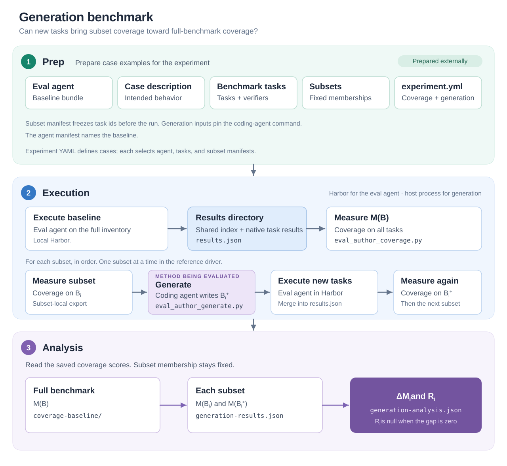

<!-- SPDX-FileCopyrightText: Copyright (c) 2026 NVIDIA CORPORATION & AFFILIATES. All rights reserved. -->
<!-- SPDX-License-Identifier: Apache-2.0 -->

# Architecture

## Can generation close a coverage gap?

Our formulation of eval authoring is based on (1) defining a list of coverage
goals and (2) generating tasks to achieve these goals. The
[metric benchmark](../../metric-benchmark/docs/architecture.md) asks whether the
coverage metric predicts evaluation quality. This benchmark fixes that metric
and asks a different question:

**Can we author new eval tasks so that coverage on a partial benchmark approaches coverage on the full benchmark?**

The experiment is a program with supplied inputs, a fixed sequence of operations,
and defined outputs. It runs the eval agent on the full task inventory, measures
coverage, then walks each prepared subset: measure that subset, generate new
tasks, run the eval agent on those tasks, and measure the expanded subset.
Analysis compares the subset scores with full-benchmark coverage. The local
Harbor implementation produces the execution results. Analysis can also consume
saved results. Execution is a replaceable component whose output is the shared
results directory.

## Experiment flow

The architecture has three phases: **prep**, **execution**, and **analysis**.
Prep prepares case examples for the experiment. The experiment consumes those
inputs, runs the eval agent, invokes generation on each subset, and analyzes
the resulting directory. Prep is external to the executable stages.



[Open the SVG diagram](assets/experiment-flow.svg).

The reference driver (`run_generation_benchmark.py`) runs subsets one after
another. After each subset it merges the new tasks into the shared case
inventory and `results.json` before the next subset. Parallel subset execution
remains future work. Optional validation after the baseline run is not part of
the reference driver yet.

## Definitions

**G** is the generation process. **A** is the eval agent that produces Harbor
evidence. **C** is the coding agent that drives task authoring inside **G**.

For each predefined subset **Bᵢ** (from `eval_subsets`):

- **M(B)** — coverage on the full task inventory, measured after the baseline run on **B**.
- **M(Bᵢ)** — coverage on the subset's tasks using baseline execution evidence for those tasks.
- **Bᵢ⁺** — the Harbor task tree **G** produces: the original **Bᵢ** tasks plus new task directories.
- **M(Bᵢ⁺)** — coverage after the eval agent runs on the new tasks and **M** reads the expanded evidence.

Improvement and gap recovery (per subset):

$$
\Delta M_i = M(B_i^+) - M(B_i), \qquad
R_i = \frac{M(B_i^+) - M(B_i)}{M(B) - M(B_i)}
$$

When **M(B) − M(Bᵢ) = 0**, **Rᵢ** is undefined. Analysis records `null` with
reason `zero_gap`. **Rᵢ > 1** means **M(Bᵢ⁺)** exceeded **M(B)** on that subset.

### What generation may see

**G** receives the subset task trees, the subset coverage score **M(Bᵢ)**, the
coverage work cell for that subset, the case description, and the generation
settings. It does not receive task artifacts from the rest of **B**, and it
does not receive **M(B)**. The reference adapter reads `authored/audit.md` and
`report.json` inside the coverage work cell. The driver does not open those
files.

**A** and **G** are separate processes. **G** is driven by coding agent **C**
(Codex CLI, Cursor agent CLI, or another pinned generator command). That
command comes from the pinned `generator_config` under `generation.yml`
`inputs`. The example config pins Codex.

## Coverage and Harbor evidence

The initial metric **M** is Eval Author coverage, through the same
`invoke_coverage` adapter as the metric benchmark. Coverage scores tasks from
Harbor trials, traces, and rewards. The driver therefore runs the baseline on
**B** and runs the eval agent on new tasks in **Bᵢ⁺** before the corresponding
measurement. If **M** requires `agent/trajectory.json` and execution did not
produce it, measurement fails. The library does not synthesize traces.

A benchmark may set `coverage.settings.before_measure_command` to an absolute
argv. The driver runs it with `GENERATION_RESULTS_ROOT` set before measurement.

Later metrics may score from task files alone. The reference driver always runs
the coverage-backed Harbor path.

**A** runs inside Harbor's task environment. **G** and **C** run as host
subprocesses, the same trust model as coverage measurement in this repository.
The example generator config pins Codex with `codex exec -s workspace-write`
(writes confined to the generation work cell), `approval_policy=never`, and
`--ephemeral`. That is a weaker boundary than the Harbor task environment:
**C** still runs as the invoking user. Running **C** inside a container remains
future work. Subset-local staging limits which files the generation request
includes.

Each generator attempt records `.eval-author/generator-logs/<slug>.prompt.md`,
`.stdout.txt`, and `.stderr.txt` under the generation work cell.

## Benchmark definition

A generation benchmark is an experiment YAML plus pinned inputs. Cases,
execution, and analysis follow the metric benchmark where those objects exist.
The [generation benchmark format](benchmark-format.md) adds `generation.yml`
for the generation adapter. It describes a baseline agent, tasks, subsets,
coverage, and a generation adapter.

| Input | Role |
| --- | --- |
| `cases.yml` `baseline` | Harbor eval agent **A** |
| task manifest | Full inventory **B** |
| `analysis.yml` subsets | Prepared subsets **{Bᵢ}** |
| `analysis.yml` description | Passed to **M** and **G** as `case_description` |
| `analysis.yml` `coverage` | **M** adapter (`command`, `settings`, timeout) |
| `analysis.yml` `scoring` | Outcome policy for Harbor results (which statuses count as complete) |
| `generation.yml` | **G** adapter: `system_id`, `revision`, `command`, `settings`, `timeout_seconds` |
| `generation.yml` `inputs` | Pinned sidecar files for the eval agent config and the generator config |

### Generation adapter contract

The orchestrator follows the same request and receipt pattern as
`metric_benchmark.coverage.invoke_coverage`:

1. Stage a work root per subset. The work root must not be a symlink.
2. Write `request.json` (`schema_version: 1`) with the subset id, task list, subset coverage score, case description, and generation settings. The request names the staged paths: `input/tasks/`, `input/coverage/`, and `output/tasks-generated/`.
3. Run `generation.command` with `--request request.json --output response.json`.
4. The adapter writes the expanded suite to the named output path and returns `response.json` (`new_task_ids` and the suite digest). On success the orchestrator writes `receipt.json` with request, configuration, and output file digests.

`generation.yml` `settings.draft_dir` is a path relative to the generator work
cell. **G** deposits each new Harbor task directory there. The reference
adapter copies those directories into `output/tasks-generated/`. The driver then
runs **A** on the copies. **G** may run Harbor inside the work cell for its own
checks. Those trials stay outside `draft_dir`. The benchmark does not rerun
them.

A subset that deposits no draft still completes. **M(Bᵢ⁺)** is measured on the
unchanged subset, so **ΔMᵢ** records that outcome. The experiment does not
require every subset, or any subset, to produce a draft. Skill acceptance is
not an experiment result.

**G** must leave the staged inputs unchanged. A failure leaves diagnostics in
the work root and does not publish a completion receipt.

The reference adapter is `eval_author_generate.py`. It calls the
eval-author-task-create skills, the same way `eval_author_coverage.py` calls
the coverage measurement. It is the component that reads `authored/audit.md`
and `report.json` from `input/coverage/`.

## Eval agent and coding agent

| | **A** | **C** |
| --- | --- | --- |
| Purpose | Run tasks in Harbor and produce traces for **M** | Drive task authoring inside **G** |
| Config location | `agents/<case>/` in prep | Pinned generator config under `generation.yml` `inputs` |
| Execution | Harbor, via the generation driver | Subprocess inside the generation adapter |
| Environment | Harbor task environment | Host subprocess |

## Artifacts

| Artifact | Location |
| --- | --- |
| Execution results | `execution-results/<case>/results.json` — same results object as the metric benchmark (`run_id`, `task_inventory`, `execution_results`) |
| Coverage scores | `coverage-baseline/` and per-subset coverage directories |
| Generation results | `generation-results.json` (generation mode, per-subset receipts) |
| Analysis | `generation-analysis.json` (**ΔMᵢ**, **Rᵢ**, and cohort summaries) |

Per-subset generation work cell:

```text
generate-<eval_subset_id>/
  request.json
  input/tasks/…
  input/coverage/…
  output/tasks-generated/…
  response.json
  receipt.json
```

## Non-goals

- Several generation systems in one benchmark revision. Compare them as separate benchmark revisions.
- A second task inventory beside **B** in the same YAML.
- Harbor-in-Harbor loops for **G**.
- Mutant scores or correlation with ablation scores.
- Accepting precomputed coverage or generation output without a subprocess receipt.
- An orchestrator sandbox around **G** beyond the pinned generator command.
