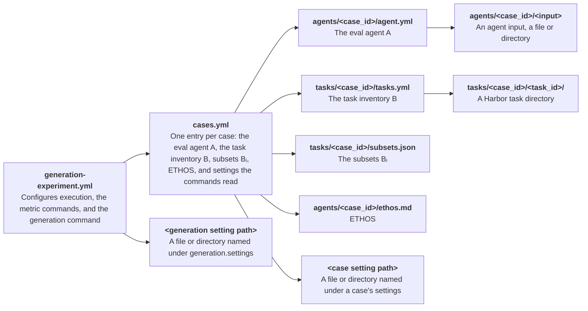

<!-- SPDX-FileCopyrightText: Copyright (c) 2026 NVIDIA CORPORATION & AFFILIATES. All rights reserved. -->
<!-- SPDX-License-Identifier: Apache-2.0 -->

# Benchmark format

`generation-experiment.yml` names the case list, the Harbor settings, a metric, and a generator command. The metric has a score command and an optional setup command, each with an output type. The commands are shared by every case. [Cases](architecture.md#cases) defines a case.



`generation-experiment.lock.json` sits beside the experiment file, which no file references. The lock takes the experiment file's stem, so `<name>.yml` has `<name>.lock.json`. [Lock file](#lock-file) describes it. The work root has its own `generation-inputs.json`, described under [work root](architecture.md#work-root).

Task and subset files use the same shapes as the metric benchmark. Host Harbor jobs are in [architecture](architecture.md#host-harbor-jobs).

`B` is the prepared local task inventory.

## Experiment

`sign-generation` writes every digest to the [lock file](#lock-file).

```yaml
benchmark_id: <text>
revision: 1
cases:
  path: cases.yml
execution:
  backend: local_harbor
  harbor_version: "0.24.0"
  n_concurrent_trials: 1
  environment:
    type: docker
metric:
  setup:                              # optional
    command: [/abs/setup]
    digest:                           # optional; fingerprints the command's code
      method: glob
      patterns: [<glob>]
      excludes: [<glob>]              # optional
    timeout_seconds: <seconds>
    output:
      python: /abs/python
      type: pkg.contracts:SetupOutput
  score:
    command: [/abs/metric]
    digest:                           # optional
      method: command
      command: [<argv>]
    timeout_seconds: <seconds>
    output:                           # optional; extends ScoreOutput
      python: /abs/python
      type: pkg.contracts:ScoreOutput
generation:
  command: [/abs/python, /abs/generator]
  digest:                             # optional
    method: glob
    patterns: [<glob>]
  timeout_seconds: 14400
  settings:
    <name>: <value>
    <file>:
      path: <path>
```

`revision` is an integer greater than or equal to 1. Unknown fields are rejected. `cases` is a file reference, resolved from this file's directory.

`harbor_version` is `0.24.0`. `n_concurrent_trials` is the width of the stage 1 and stage 4 Harbor jobs. Width does not change what a trial measures, so it is not part of a job's identity. Harbor `max_retries` is 0.

`digest` is optional on each command block (`metric.setup`, `metric.score`, and `generation`). It fingerprints the code that the command runs, which the orchestrator cannot see. Without it, the lock pins the block's fields and not the command's code. `method` is one of:

- `glob`: `patterns` match files relative to the file that declares the digest, and `excludes` removes matches. The [skipped names](#skipped-names) are always excluded. The digest covers the sorted relative paths and the bytes of the matched files. A pattern that matches no file is an error.
- `command`: `command` is an argv that runs in the directory that contains the file that declares the digest. The digest is of its stdout. A non-zero exit is an error. The command may report anything, such as a git commit, an image id, or a checksum of a tree.

The orchestrator stores the method's result and compares it on later runs. A method that changes while the code it fingerprints has not is the user's responsibility.

A new digest changes the identity of its block and reruns the stages that read it.

`timeout_seconds` bounds each command's run. See [command invocation](architecture.md#command-invocation).

## Cases: `cases.yml`

```yaml
- case_id: <case_id>
  agent:
    path: agents/<case_id>/agent.yml
  tasks:
    path: tasks/<case_id>/tasks.yml
  subsets:
    path: tasks/<case_id>/subsets.json
  ethos:
    path: agents/<case_id>/ethos.md
  agent_source_excludes: []           # prefixes left out of the staged agent tree
  settings:                           # freeform, read by the commands
    <name>: <value>
```

The document is a nonempty list, with unique case ids. A case selects an agent manifest, a task manifest, its subset manifest, its ETHOS, and its settings. The subset manifest has the metric benchmark's [`subsets.json` shape](../../metric-benchmark/docs/benchmark-format.md#subsets-subsetsjson). Generation uses the subset ids and the task ids in each subset. `settings` follows the rule for `generation.settings`: a mapping with a `path` key is a file reference that the lock pins. The commands decide what they read. Paths resolve from the directory that contains `cases.yml`.

## Agent and task files

`agent.yml` names `A`, the eval agent. Harbor for `A`, `oracle`, and `nop` on the host loads the agent class in the stage process. `path` on an agent input is relative to the directory that contains `cases.yml`. A Harbor value that is exactly `{input:NAME}` is replaced with the absolute path of that input when the host builds the job. The copy of the `harbor` block in `request.json` leaves those templates unresolved.

`agent.yml` may declare `digest`, the same block as a command `digest`. When it is declared, the lock has `cases[<case_id>].agent.digest`. Without it, the lock pins `agent.yml` and each agent input, and not a separate fingerprint of the agent's code.

The lock records the digest of each agent input and each task. `agent.yml` and `tasks.yml` take no `sha256` fields; the generation loader rejects them, and the lock is the only place digests live.

## Generation

Paths under `generation` resolve from the directory that contains `generation-experiment.yml`. The loader rejects `${` in that file.

`generation.settings` is a freeform mapping copied onto the request. The command interprets it and may use it to start sidecars. The orchestrator treats every mapping under `settings` that has a `path` key as a file reference and pins it. A changed file changes the identity of the `generation` block and reruns generation. The reference generator's settings are in [reference generator implementation](reference-generator-implementation.md#settings).

## Metric

`metric.setup.command` is stage 0 and is optional. Refer to [metric setup](architecture.md#metric-setup). `metric.score.command` is stages 1, 2, and 4. Refer to [host measurement](architecture.md#host-measurement). The two commands belong to one metric and need not be the same executable. Both follow the [command invocation](architecture.md#command-invocation) contract.

`output` declares the type of what an invocation writes. `setup.output` declares `metric-setup/` and is required when `setup` is declared. `score.output` declares the metric output and is optional. `type` is `module:Class`, a `DirectoryModel` subclass that the orchestrator loads with `python` in a subprocess. Consumers read the producer's type, so there is no separate declaration for them. Without `setup`, there is no `metric-setup/`, and the score command gets no setup input. See [metric contracts](architecture.md#metric-contracts).

The score is part of the contract. `metric.score.command` writes `score.json` in the metric output directory. It holds a `Score`: a finite `value`, or a null `value` with a `missing_score_reason`. The base type `ScoreOutput` loads `score.json`. `score.output` is optional. When given, it must extend `ScoreOutput` and add the files that `G` reads, such as a gap report. When omitted, the metric output is `ScoreOutput`.

## Lock file

`labs/generation-benchmark/tools/sign-generation <name>.yml [--resign | --check]` writes `<name>.lock.json` beside the experiment file. The tool edits no other file. When `generation.settings` names `operator_answers`, the tool validates that file. When it names `image_id`, the tool checks that Docker has that image and that its source label equals the lock's `generation.digest`.

A pin fixes the expected contents of a prepared input, or of the code that produces tasks or scores. A stage reuses its output only while its pins match, and two runs with the same pins read the same inputs. A pin does not authenticate a publisher.

```json
{
  "schema": "nemo.eval_author.generation_lock.v1",
  "entries": {
    "cases": {
      "type": "file",
      "path": "cases.yml",
      "sha256": "sha256:<64 hex>"
    },
    "cases[<case_id>].agent": {
      "type": "file",
      "path": "agents/<case_id>/agent.yml",
      "sha256": "sha256:<64 hex>"
    },
    "cases[<case_id>].agent.inputs.<name>": {
      "type": "file",
      "path": "<path of the input>",
      "sha256": "sha256:<64 hex>"
    },
    "cases[<case_id>].agent.digest": {
      "type": "digest",
      "path": "agents/<case_id>/agent.yml",
      "selector": "digest",
      "sha256": "sha256:<64 hex>"
    },
    "cases[<case_id>].ethos": {
      "type": "file",
      "path": "agents/<case_id>/ethos.md",
      "sha256": "sha256:<64 hex>"
    },
    "cases[<case_id>].subsets": {
      "type": "file",
      "path": "tasks/<case_id>/subsets.json",
      "sha256": "sha256:<64 hex>"
    },
    "cases[<case_id>].tasks": {
      "type": "file",
      "path": "tasks/<case_id>/tasks.yml",
      "sha256": "sha256:<64 hex>"
    },
    "cases[<case_id>].tasks.<task_id>": {
      "type": "directory",
      "path": "<path of the task directory>",
      "sha256": "sha256:<64 hex>"
    },
    "cases[<case_id>].settings.<name>": {
      "type": "file",
      "path": "<path of the setting>",
      "sha256": "sha256:<64 hex>"
    },
    "execution": {
      "type": "block",
      "path": "generation-experiment.yml",
      "selector": "execution",
      "sha256": "sha256:<64 hex>"
    },
    "metric": {
      "type": "block",
      "path": "generation-experiment.yml",
      "selector": "metric",
      "sha256": "sha256:<64 hex>"
    },
    "metric.setup.digest": {
      "type": "digest",
      "path": "generation-experiment.yml",
      "selector": "metric.setup.digest",
      "sha256": "sha256:<64 hex>"
    },
    "metric.setup.output.type": {
      "type": "module",
      "path": "<path of the module file>",
      "selector": "<Class>",
      "sha256": "sha256:<64 hex>"
    },
    "metric.score.digest": {
      "type": "digest",
      "path": "generation-experiment.yml",
      "selector": "metric.score.digest",
      "sha256": "sha256:<64 hex>"
    },
    "metric.score.output.type": {
      "type": "module",
      "path": "<path of the module file>",
      "selector": "<Class>",
      "sha256": "sha256:<64 hex>"
    },
    "generation": {
      "type": "block",
      "path": "generation-experiment.yml",
      "selector": "generation",
      "sha256": "sha256:<64 hex>"
    },
    "generation.digest": {
      "type": "digest",
      "path": "generation-experiment.yml",
      "selector": "generation.digest",
      "sha256": "sha256:<64 hex>"
    },
    "generation.settings.<file>": {
      "type": "file",
      "path": "<path of the setting>",
      "sha256": "sha256:<64 hex>"
    }
  }
}
```

A key names a field by its reference chain from the experiment file.

Each entry has these fields:

- `type` is `file`, `directory`, `block`, `module`, or `digest`.
- `path` is the file or directory that the entry names. For a `block` or a `digest`, it is the file that holds the declaration. For a `module`, it is the module file. It is relative to the directory that contains the experiment file.
- `selector` is the location inside `path`. For a `block` or a `digest`, it is the location of the block in the file. For a `module`, it is the class. Other entries have none.
- `sha256` is the digest of what the entry names: the bytes of a file, the canonical content of a directory, the identity form of a block, the whole module file of a `module`, or the result of the `digest` method.

Moving a file changes its `path`, and the digest and key stay the same. `--check` reports the changed `path`, and `--resign` rewrites it.

A key for a file follows `path` references from the experiment. For `cases[smoke].agent.inputs.script`:

```text
generation-experiment.yml   cases.path              -> cases.yml                  key: cases
cases.yml                   [smoke].agent.path      -> agents/smoke/agent.yml     key: cases[smoke].agent
agent.yml                   inputs.script.path      -> agents/smoke/script.py     key: cases[smoke].agent.inputs.script
```

The entry has `type` `file`, `path` `agents/smoke/script.py`, and the digest of `script.py` as `sha256`. Agent input paths resolve from the directory that contains `cases.yml`. When the path is a directory, the entry's `type` is `directory`.

A key for a block names a block in a file. The entry for `generation` has `type` `block`, `path` `generation-experiment.yml`, and `selector` `generation`. Its `sha256` is the identity form of that block, described next. `execution` and `metric` work the same way.

`metric.setup.output.type` and `metric.score.output.type` name a `module:Class`. Their entries have `type` `module`, the module file as `path`, and the class as `selector`, and exist only when declared. The digest covers the whole module file. A `digest` entry exists only when its block declares `digest`. Its `selector` is the block's location, such as `generation.digest` or `digest` in `agent.yml`, and `sign-generation` runs the method to get its `sha256`. `cases[<case_id>].agent.digest` is absent when `agent.yml` declares no `digest`.

The identity form of a block is its parsed model with the non-identity fields dropped and each nested reference replaced by its content digest. Comments, key order, and formatting do not change it. A changed command string does. The models mark the non-identity fields: `benchmark_id`, `revision`, and `execution.n_concurrent_trials`. Every other field is an identity field. A `digest` counts as a nested reference, so each block's identity form includes the result of its digest.

`sign-generation` checks that the case files, the commands, the inputs in `agent.yml` and `tasks.yml`, and each declared `output` type are present. It then runs each declared `digest`, rehashes everything above from disk, and writes the lock. `--check` writes nothing. It fails when the lock lacks a key that the models derive, holds a key that they do not, or holds an entry whose `sha256`, `path`, or `selector` differs from disk, and it prints the differences. `--resign` replaces an existing lock with the current state of disk. A second write without `--resign` fails and lists the keys. A stage loader verifies the entries it reads. A missing or different digest is a stage error that names the key.

The implementation digest covers `labs/generation-benchmark/**/*.py`, the installed Harbor version, and the installed pydantic version. It is recorded in the work root's `generation-inputs.json` and is part of the generation receipt's configuration digest.

## Skipped names

A directory hash, a `glob` digest, and every staging copy skip the path components `.git` and `__pycache__`, files ending `.pyc`, and files named `.DS_Store`. `agent_source_excludes` is a list of path prefixes. A `glob` `excludes` is a list of globs.
