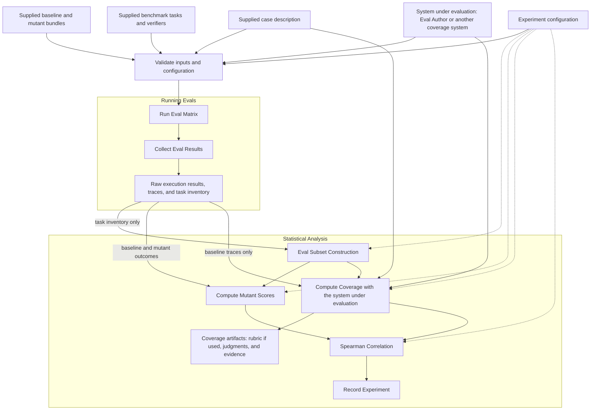

<!-- SPDX-FileCopyrightText: Copyright (c) 2026 NVIDIA CORPORATION & AFFILIATES. All rights reserved. -->
<!-- SPDX-License-Identifier: Apache-2.0 -->

# Architecture

## Scientific question

Does a coverage measurement predict how effectively an evaluation set detects
agent degradation?

For each supplied case, run the baseline agent and a fixed cohort of mutants
against the same benchmark tasks. Construct several subsets of those tasks.
For each subset, ask the system under evaluation to measure coverage using the
case description and permitted baseline evidence. Measure sensitivity to mutants
from the baseline and mutant outcomes. Correlate those paired scores across
subsets. The system under evaluation may be Eval Author or another coverage
system.

Compare coverage definitions using the same subsets, mutant cohort, and outcome
scoring policy. Higher mutant scores mean greater detected degradation, so the
comparison seeks a positive relationship with coverage. Correctness and resource
use are separate outcome variations. Report results per case and variation;
combining cases into a leaderboard is an open decision.

## Supplied inputs

A run receives five supplied inputs. Case packages provide the first four;
the experiment configuration specifies how to use them. Their exact packaging
format is not yet specified; these are logical contents, not a file schema.

| Input | Required contents |
| --- | --- |
| Baseline agent | An executable bundle with an immutable identity and a documented invocation contract |
| Mutants | Executable bundles with distinct identities, their baseline relationship, and mutation descriptions |
| Case description | Stable case identity and intended agent behavior; an Ethos is one possible representation |
| Benchmark tasks | Fixed task membership, task identities, environments, and correctness verifiers |
| Experiment configuration | Case-to-benchmark associations, fixed mutant cohort, execution settings, subset construction, coverage-system settings and permitted evidence, and scoring parameters |

### System under evaluation

In addition to those inputs, a run receives the versioned system whose coverage
measurements are being evaluated: Eval Author or another implementation. Record
its version, dependencies, model configuration when applicable, and effective
settings independently of the case package. Different systems can be compared
against the same cases, execution evidence, subsets, and mutant-scoring policy.

Coverage is produced during the experiment. A system that uses a rubric may
generate it as part of its coverage workflow; a rubric is not required of every
system. Retain any generated rubric, judgments, and other measurement artifacts
with the scores. The benchmark supplies the case description as context, not a
precomputed coverage answer. Whether that description must follow the Ethos
format remains open.

Baseline and mutant bundles are prepared and checked before release. Any
qualification that determines the released cohort also happens before release;
the benchmark run does not select mutants based on its observed scores.
Tasks and their environments are supplied ready for the selected execution
backend.

The configuration records all effective settings, including defaults. Each run
preserves the exact configuration and input identities. A changed bundle, task
set, case description, or coverage-system version defines a different comparison.
Generated coverage artifacts are recorded as outputs with their input identities.

## Experiment flow

The preparation portion of the original experiment becomes a supplied-input
boundary. The runnable experiment has two parts: **Running Evals** and
**Statistical Analysis**.

Record Experiment retains the inputs and every stage's outputs, including raw
execution evidence. The diagram omits those archive edges for readability.
Subset construction uses task identities and the configured sampling rule, never
observed rewards or coverage. Coverage measurement receives the case description
and explicitly permitted baseline evidence, never mutant outcomes or correlation
results. The precise access to agent source, task contents, traces, and baseline
verifier results must be fixed in the configuration and held comparable across
systems. Passing a path to the entire results directory would not enforce that
boundary.

## Component responsibilities

| Component | Responsibility |
| --- | --- |
| Case package | Supply the prepared baseline, mutants, tasks, and case metadata |
| Configuration validator | Check input and system identities, declared relationships, settings, and required capabilities before execution |
| Runner | Execute the fixed stage sequence, validate outputs, and record stage completion |
| Execution adapter | Invoke the supplied agents and tasks through the selected backend and preserve attempts and outcomes |
| Results collector | Produce a common results index while retaining native traces and verifier evidence |
| System under evaluation | Produce coverage scores from the case description and permitted baseline evidence, including rubric generation if its method requires it |
| Analysis functions | Construct subsets, compute mutant scores, join score dictionaries, and compute correlations |
| Experiment record | Preserve the configuration, input and system identities, execution evidence, generated coverage artifacts, scores, exclusions, and completion status |

The execution adapter is a portability boundary. This design requires no
particular hosted service, registry, deployment, or orchestration product.
Supporting a backend requires defining and testing its invocation and evidence
contract; the adapter box alone does not establish portability.

Owned configuration and artifact formats should use shared, versioned data
models with one validation and serialization implementation. Native trace and
task formats retain their established readers. Concrete schemas and interfaces
are not defined by this documentation.

## Determinism

The runner uses explicit code and configuration for stage ordering, retries,
completion checks, and analysis. No coordinating language model chooses the
next step, changes scoring rules, or repairs an experiment during execution.

For fixed execution evidence and recorded coverage outputs, subset membership
and statistical results must be reproducible. This requires stable task ordering,
a specified sampling algorithm
and seed or supplied memberships, fixed scoring rules, pinned implementations,
and explicit treatment of missing values and ties. Completion order must not
change which attempts or observations are scored.

Live agent calls, generated rubrics, and model-based coverage judgments can still
vary. Pinning a model name, setting a seed, or choosing temperature zero does not by itself
establish identical results. Wall-clock measurements can also vary between runs.
The draft therefore does not yet promise full reproducibility of fresh live
executions.

To support an end-to-end deterministic claim, we must choose whether the benchmark
requires deterministic agents and coverage systems, replays previously recorded
execution and coverage evidence, or defines determinism only for orchestration
and analysis over frozen observations. Replay would test analysis
reproducibility; by itself it would not test new live agent behavior or new
model-generated rubrics and judgments. Replaying an earlier coverage score does
not evaluate a new version of the coverage system.

## Open decisions

- **Determinism scope:** choose the guarantee for live execution, coverage
  judgments, and replay before describing the benchmark as fully deterministic.
- **Distribution:** choose the case package format, bundle invocation contract,
  supported task format, and initial execution backend.
- **Case description:** decide whether an Ethos is required or whether other
  descriptions of intended agent behavior are accepted.
- **Execution policy:** specify repetitions, seeds, timeouts, retry limits,
  attempt selection, and treatment of incomplete agent-task pairs.
- **Coverage interface and evidence:** define the common score interface, which
  baseline artifacts each system can see, and whether it can inspect the full
  benchmark or only the subset being scored. For systems that generate a rubric,
  specify its generation scope and reuse across subsets. Keep mutant outcomes
  and correlation results inaccessible to coverage computation.
- **Scoring:** choose the primary mutant score, mutant weighting, coverage
  aggregation, resource measurements, and treatment of partially observed subsets.
- **Statistical reporting:** choose subset sizes and overlap constraints,
  uncertainty estimates that account for shared tasks, and any cross-case summary.
- **Meaning of mutant score:** mutation sensitivity is a proxy for evaluation
  quality. Baseline failures, irrelevant mutants, and ceiling or floor effects
  can weaken that proxy even when the execution and analysis are correct.

These choices are intentionally unresolved. No command-line interface, public
dataset release, or runnable experiment is implied by this draft.
