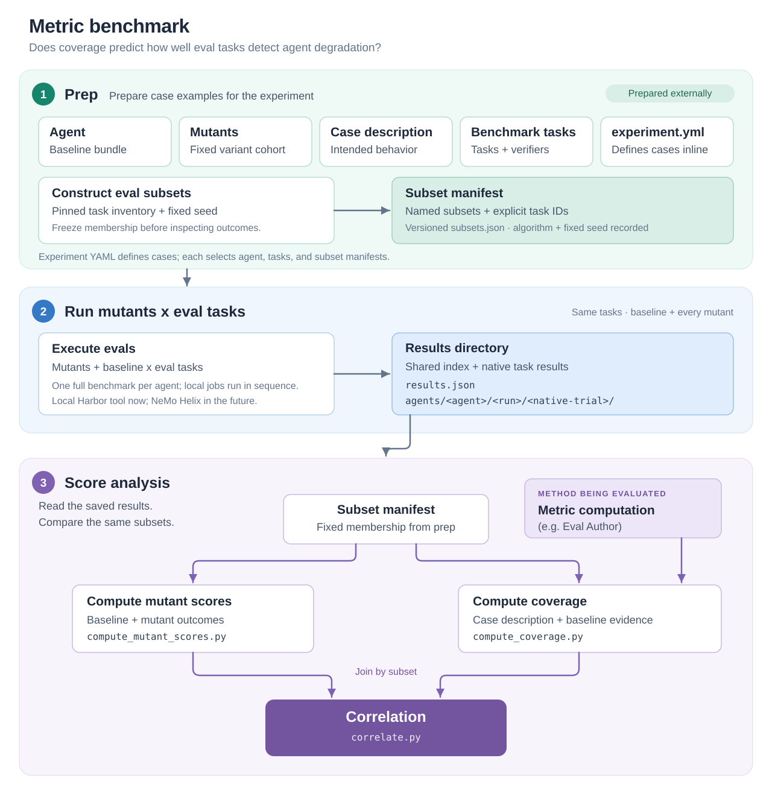
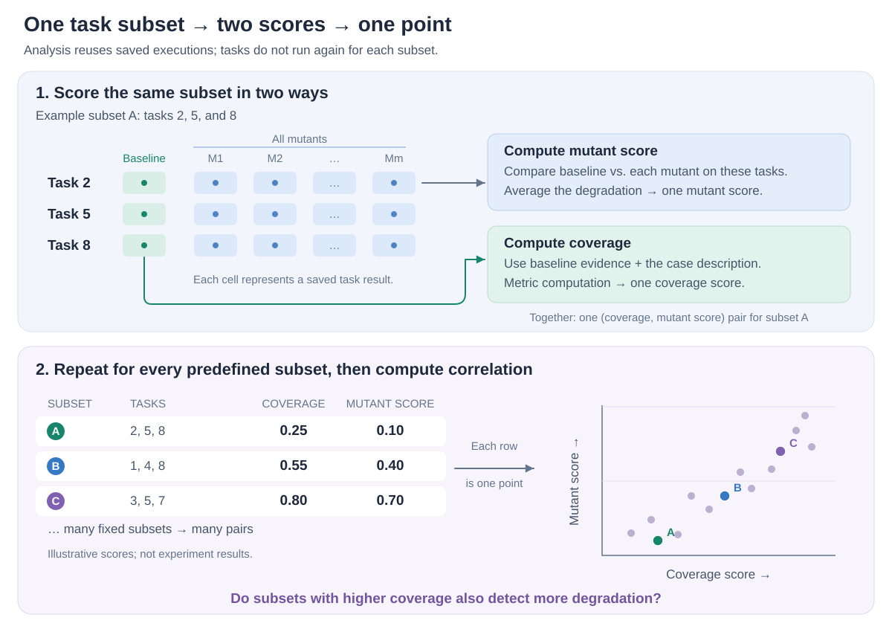

<!-- SPDX-FileCopyrightText: Copyright (c) 2026 NVIDIA CORPORATION & AFFILIATES. All rights reserved. -->
<!-- SPDX-License-Identifier: Apache-2.0 -->

# Architecture

## Evaluating Eval Coverage

Our formulation of eval authoring is based on (1) defining
a list of coverage goals and (2) generating tasks to achieve these goals. We
evaluate our ability to do this separately.

The question we answer here is **Is our coverage metric a good predictor for agentic evaluation quality?**

This is a hard question to answer. Benchmarking a _metric_ is a more complicated ask than simply benchmarking an
agent's ability to perform verifiable tasks. Our approach is to conduct an experiment based on mutation
testing (see [Mutation testing — Wikipedia](https://en.wikipedia.org/wiki/Mutation_testing)),
measuring the correlations between the ability of eval tasks to detect mutants and their coverage.

The experiment is a program with supplied inputs, a fixed sequence of operations,
and defined outputs. It executes benchmark tasks against the baseline agent and
a fixed cohort of mutants. Its analysis consumes predefined task subsets, computes a
mutant score for each subset, invokes the coverage tool on the same subsets, and
correlates the two scores. The current implementation starts from saved execution
results. Execution is a replaceable component whose output is a shared results
directory consumed by analysis.

Comparisons between coverage tools use the same subsets, mutant cohort, and
outcome scoring policy. Higher mutant scores mean greater detected degradation,
so the comparison seeks a positive relationship with coverage. Each analysis
produces a result for one case and one outcome measurement, such as correctness
or resource use. Results are reported per case and measurement.

## Experiment flow

The architecture has three phases: **prep**, **run mutants x eval tasks**, and
**score analysis**. Prep prepares case examples for the experiment. The experiment
consumes those inputs, runs the baseline and mutants against the eval tasks,
and analyzes the resulting directory. Execution and score analysis contain four
executable stages: run mutants x eval tasks, compute mutant scores, compute
coverage, and correlation. Prep is external to those stages.

[Open the SVG diagram](assets/experiment-flow.svg).

## Benchmark definition

A fixed metric benchmark consists of linked, content-pinned manifests:

- **Experiment YAML (`experiment.yml`):** lists cases and configures execution,
  metric computation, and scoring.
- **Case manifest (`case.yml`):** combines an agent manifest, a tasks manifest,
  and a prepared subset manifest.
- **Agent manifest (`agent.yml`):** defines the baseline, mutants, and intended
  behavior description, with pinned references to prepared dependencies.
- **Tasks manifest (`tasks.yml`):** defines the fixed inventory and pinned task locations.
- **Subset manifest:** records the list of exact task memberships and their
  preparation seed. It is bound to the task inventory, independently of case IDs.

Prep produces these fixed inputs. Cases can share agents, tasks and subsets;
experiments select cases without repeating or modifying their definitions.
Different metric configurations can reuse the same prepared inputs.

After unpacking a benchmark, all paths resolve relative to the bundle root—the
folder containing the experiment YAML. Nested manifests can reference shared
inputs without `../`. SHA-256 pins verify each link. The
[tool guide](tools.md#experiment-and-prepared-manifests) specifies the directory
layout and fields. Each execution produces its own results while retaining the
configured input identities.

## 1. Prep

Prep prepares case examples for the experiment. This case-construction process
is outside this repository and the experiment itself. It produces the
baseline agent, creates and qualifies its mutants, and assembles the case
description, task set, and configuration in the benchmark's input format. Prep
also constructs the eval subsets and bundles their manifest with the task set.
Prep emits `experiment.yml` referencing these outputs. Released benchmarks
include the YAML definition and its prepared case examples. The experiment
consumes them; it does not regenerate or select mutants based on its results.

### Supplied inputs

A run receives five supplied inputs. Case packages provide the first four;
the experiment configuration specifies how to use them. The table describes
their logical contents.

| Input | Required contents |
| --- | --- |
| Baseline agent | An executable bundle with an immutable identity and a documented invocation contract |
| Mutants | Executable bundles with distinct identities, their baseline relationship, and mutation descriptions |
| Case description | Stable case identity and intended agent behavior; an Ethos is one possible representation |
| Benchmark tasks | Fixed task membership, task identities, environments, correctness verifiers, and a versioned subset manifest |
| Experiment configuration | `experiment.yml`: pinned case-manifest references, execution settings, coverage-system settings and permitted evidence, and scoring parameters |

Baseline and mutant bundles are prepared and checked before release.
Tasks and their environments are ready for execution. At present only Harbor tasks are used.

The configuration supplies the choices that determine execution: the fixed subset manifest,
selected agent runs, scoring rules, and the coverage-tool command and settings.
The program validates these inputs before using them. Missing or inconsistent
inputs cause an error.

### Subset manifest

Prep constructs subsets from the pinned task inventory, before inspecting
execution outcomes or coverage scores. Each case references a subset manifest, a
pinned artifact containing stable subset IDs, a list of task IDs for each subset,
and preparation parameters such as the fixed seed. Subset IDs can be readable
names or numbers. Task revisions live in `tasks.yml`; the subset manifest does
not duplicate task definitions or the inventory.

The manifest is authoritative: every run and metric tool uses the same explicit
memberships. The seed documents construction and stays fixed for that benchmark
version; analysis does not resample or regenerate subsets. Changing the seed,
inventory, or memberships changes the subset and case pins; existing experiments
continue to reference their original prepared cases. Analysis validates
subset task IDs against `tasks.yml` and checks the execution inventory against
those task definitions, including their revisions.
Missing results follow the scoring policy without changing subset membership.

## 2. Run mutants x eval tasks

This stage executes the same benchmark tasks against the baseline and every
selected mutant. Its two architectural components
are the **execution implementation** and the **results-directory interface**.

| Component | Role |
| --- | --- |
| Execution implementation | Runs the configured agent-by-task matrix and assembles its outputs. The initial implementation is a simple local Harbor loop, one agent's full benchmark at a time. A future NeMo Helix implementation will orchestrate evaluations at scale. |
| Results directory | Carries the task inventory, agent/task identities, statuses, measurements, and native evidence into analysis. Both execution implementations produce the same contract. |

The proposed layout is agent-first: `agents/<agent>/<run>/<native-trial>/`, with
`results.json` at the root indexing those trial results. Each run contains the
native output of that agent running the benchmark. The
[results-directory contract](stages.md#results-directory-contract) specifies the
layout. Invocation, scheduling, and collection are internal to the execution
implementation; they do not add generic experiment stages.

## 3. Score analysis

Score analysis consumes the results directory and produces the benchmark's score.
It consists of three components. Mutant scoring and coverage consume the prepared
subset manifest and execution outputs; correlation consumes their derived scores. None of
these components reruns the benchmark tasks.

For each subset in the manifest, analysis selects those tasks' saved results for
the baseline and every mutant. Comparing their outcomes produces one mutant
score for the subset. Separately, metric computation uses that same subset's
baseline evidence and the case description to produce one coverage score.
Repeating this for all predefined subsets gives one pair of scores per subset.
Each point in the figure represents a subset; correlation measures whether
subsets with higher coverage tend to detect more degradation. The example
values are illustrative. Subsets may overlap, so these points are not independent
observations. The reported correlation is descriptive, without independent-sample
significance claims.

| Component | Inputs | Output |
| --- | --- | --- |
| Compute Mutant Scores | Subset manifest and baseline/mutant measurements from `results.json` | A mutant-sensitivity score for each subset |
| Compute Coverage | Subset manifest, case description, and indexed baseline evidence, evaluated with the configured system | A coverage score for each subset and any artifacts generated by that method |
| Correlation | Coverage and mutant scores joined by subset ID | Correlation across subsets, with paired values and any exclusions |

The Python analysis runner validates the inputs and invokes these components in
a fixed order. Subset membership is fixed during prep. Coverage receives baseline evidence without mutant outcomes or
correlation results. The experiment ends with correlation; output storage and
packaging are implementation details.

Mutant scoring uses mean signed baseline-to-mutant degradation, with equal
weight for tasks and mutants. Correlation compares the ranks of the paired
scores, with average ranks for ties. The [component descriptions](stages.md#2-compute-mutant-scores)
specify these calculations and the handling of missing or undefined values.

### Metric computation (e.g. Eval Author)

Eval Author is the primary system under evaluation. For each task subset, the
runner supplies the case description, task identities, and baseline execution
evidence, and obtains a coverage score. The correlation stage compares those
scores with the independently computed mutant scores.

Coverage computation may include rubric generation or model calls as part of
the system's method. Coverage scores and any generated rubrics are experiment
outputs. The Python runner controls stage ordering, validation, and result
storage.

Tool-specific adapters provide the common invocation interface needed to
evaluate other systems, such as skill-based or LangChain-based workflows.
They handle differences in native inputs, runtimes, and outputs; the experiment
still performs the same Compute Coverage stage. Each adapter defines and validates the native inputs and outputs required by
its system.

## Benchmark orchestration

This benchmark runs the same Harbor tasks against multiple versions of an agent:
the baseline and its mutants. A lightweight experiment runner coordinates those
runs and analyzes their combined results. Harbor's verifiers score individual
task executions; the metric benchmark's score is computed across many executions
by comparing coverage with mutant sensitivity across task subsets. That analysis
sits above Harbor, so the runner provides the orchestration and scoring that a
single Harbor job or task verifier does not. This control flow is deterministic
Python code.

### Stage tools and Python libraries

Each executable experiment stage has a Python tool and an importable Python
API. The orchestrator reads and validates `experiment.yml`, resolves its inputs,
and calls these APIs in dependency order, passing each stage's outputs to the
next. The command-line tools expose the same operations for standalone use.
Stage behavior lives in these reusable tools; the orchestrator supplies the
configuration and coordinates their execution.

| Stage | Python tool / library operation |
| --- | --- |
| Execute evals | Local Harbor execution tool, or a future NeMo Helix execution tool; both expose the same results-directory contract |
| Compute mutant scores | `compute_mutant_scores.py` / `metric_benchmark.scoring.compute_mutant_scores` |
| Compute coverage | `compute_coverage.py` / `metric_benchmark.coverage.invoke_coverage` |
| Correlation | `correlate.py` / `metric_benchmark.correlation.correlate` |

External prep builds the benchmark and its fixed subset manifest. The
experiment runner consumes those artifacts. Execution tools
can have multiple implementations without changing the analysis tools or their
input contract.
