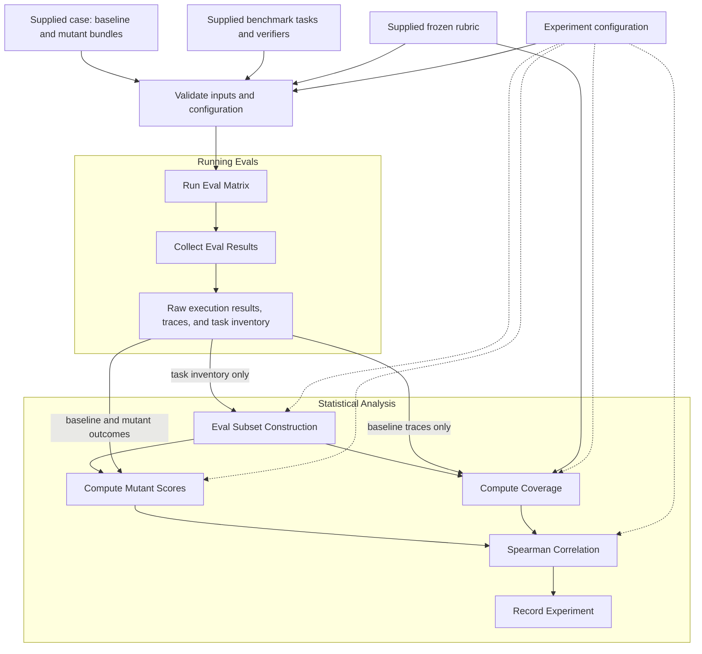

<!-- SPDX-FileCopyrightText: Copyright (c) 2026 NVIDIA CORPORATION & AFFILIATES. All rights reserved. -->
<!-- SPDX-License-Identifier: Apache-2.0 -->

# Architecture

## Scientific question

Does a coverage measurement predict how effectively an evaluation set detects
agent degradation?

For each supplied case, run the baseline agent and a fixed cohort of mutants
against the same benchmark tasks. Construct several subsets of those tasks.
For each subset, measure coverage from the baseline's traces and sensitivity to
mutants from the baseline and mutant outcomes. Correlate those paired scores
across subsets.

Compare coverage definitions using the same subsets, mutant cohort, and outcome
scoring policy. Higher mutant scores mean greater detected degradation, so the
comparison seeks a positive relationship with coverage. Correctness and resource
use are separate outcome variations. Report results per case and variation;
combining cases into a leaderboard is an open decision.

## Supplied inputs

A benchmark release provides prepared case packages. Their exact packaging format
is not yet specified; the following are logical contents, not a file schema.

| Input | Required contents |
| --- | --- |
| Case description | Stable case identity, intended agent behavior, and its associated benchmark |
| Baseline agent | An executable bundle with an immutable identity and a documented invocation contract |
| Mutants | Executable bundles with distinct identities, their baseline relationship, and mutation descriptions |
| Benchmark tasks | Fixed task membership, task identities, environments, and correctness verifiers |
| Coverage rubric | A frozen definition of the coverage items and denominator for each selected metric configuration |
| Experiment configuration | Case selection, fixed mutant cohort, metric implementation versions, execution settings, subset construction, and scoring parameters |

Baseline and mutant bundles are prepared and checked before release. Any
qualification that determines the released cohort also happens before release;
the benchmark run does not select mutants based on its observed scores.
Tasks and their environments are supplied ready for the selected execution
backend. The rubric is treated as another supplied input in this draft, so rubric
generation is outside the measured run.

The configuration records all effective settings, including defaults. Each run
preserves the exact configuration and input identities. A changed bundle, task
set, rubric, or metric version defines a different comparison.

## Experiment flow

The preparation portion of the original experiment becomes a supplied-input
boundary. The runnable experiment has two parts: **Running Evals** and
**Statistical Analysis**.

Record Experiment retains the inputs and every stage's outputs, including raw
execution evidence. The diagram omits those archive edges for readability.
Subset construction uses task identities and the configured sampling rule, never
observed rewards or coverage. Coverage measurement receives baseline evidence;
mutant outcomes are available only to mutant scoring and the final analysis.

## Component responsibilities

| Component | Responsibility |
| --- | --- |
| Case package | Supply the prepared baseline, mutants, tasks, and case metadata |
| Configuration validator | Check input identities, declared relationships, settings, and required capabilities before execution |
| Runner | Execute the fixed stage sequence, validate outputs, and record stage completion |
| Execution adapter | Invoke the supplied agents and tasks through the selected backend and preserve attempts and outcomes |
| Results collector | Produce a common results index while retaining native traces and verifier evidence |
| Metric implementation | Measure baseline traces against the supplied coverage definition |
| Analysis functions | Construct subsets, compute mutant scores, join score dictionaries, and compute correlations |
| Experiment record | Preserve the configuration, input identities, evidence, scores, exclusions, and completion status |

The execution adapter is a portability boundary. This design requires no
particular hosted service, registry, deployment, or orchestration product.
Supporting a backend requires defining and testing its invocation and evidence
contract; the adapter box alone does not establish portability.

Owned configuration and artifact formats should use shared, versioned data
models with one validation and serialization implementation. Native trace and
task formats retain their established readers. Concrete schemas and interfaces
are not defined by this documentation.

## Determinism

The runner uses explicit code and configuration for stage ordering, retries,
completion checks, and analysis. No coordinating language model chooses the
next step, changes scoring rules, or repairs an experiment during execution.

For fixed input evidence, subset membership and numerical results must be
reproducible. This requires stable task ordering, a specified sampling algorithm
and seed or supplied memberships, fixed scoring rules, pinned implementations,
and explicit treatment of missing values and ties. Completion order must not
change which attempts or observations are scored.

Live agent calls and model-based coverage judgments can still vary. Pinning a
model name, setting a seed, or choosing temperature zero does not by itself
establish identical results. Wall-clock measurements can also vary between runs.
The draft therefore does not yet promise full reproducibility of fresh live
executions.

To support an end-to-end deterministic claim, we must choose whether the benchmark
requires deterministic agents and metric implementations, replays supplied
execution and judgment evidence, or defines determinism only for orchestration
and analysis over frozen observations. Replay would test analysis
reproducibility; by itself it would not test new live agent behavior or new
model-generated judgments.

## Open decisions

- **Determinism scope:** choose the guarantee for live execution, coverage
  judgments, and replay before describing the benchmark as fully deterministic.
- **Distribution:** choose the case package format, bundle invocation contract,
  supported task format, and initial execution backend.
- **Rubric ownership:** confirm that frozen rubrics ship with case packages,
  or define how independently supplied metric configurations bind to them.
- **Execution policy:** specify repetitions, seeds, timeouts, retry limits,
  attempt selection, and treatment of incomplete agent-task pairs.
- **Coverage interface:** define how a metric consumes baseline traces, which
  evidence is required, and whether it may make model calls.
- **Scoring:** choose the primary mutant score, mutant weighting, coverage
  aggregation, resource measurements, and treatment of partially observed subsets.
- **Statistical reporting:** choose subset sizes and overlap constraints,
  uncertainty estimates that account for shared tasks, and any cross-case summary.

These choices are intentionally unresolved. No command-line interface, public
dataset release, or runnable experiment is implied by this draft.
