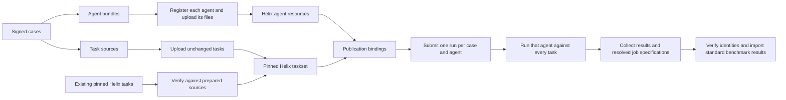

<!-- SPDX-FileCopyrightText: Copyright (c) 2026 NVIDIA CORPORATION & AFFILIATES. All rights reserved. -->
<!-- SPDX-License-Identifier: Apache-2.0 -->

# Helix benchmark architecture

This design separates **the experiment**, **publishing its resources**, and **running it**.
The following PRs implement this contract; the examples describe the intended interface.

## Resource flow

## Decisions

1. **Agents are independent resources.** Register each baseline and mutant from its
   own signed bundle. Upload associated files through the agent's FileSet.
   Do not copy agent bundles into task images.
2. **Tasks stay unchanged.** Upload prepared task directories without editing their
   Dockerfiles. Alternatively, use an existing task reference pinned to a revision,
   after checking it against the prepared source.
3. **Cases remain the experiment definition.** Agent behavior, model and files belong
   in the signed agent bundle. Publication cannot substitute another agent.
4. **Registered agents are explicit.** An agent manifest selects either a native
   Harbor configuration or a registered bundle. The initial registered-agent path
   runs on Helix; the local executor rejects it rather than silently translating it
   into another agent.
5. **Publishing does not run evaluations.** It registers agents, uploads or verifies
   tasks, creates tasksets, requests task-image builds, and writes bindings.
6. **Execution references published resources.** Submit a registered agent reference
   and pinned taskset. Helix resolves the agent configuration and snapshots its files.
   Agent changes never require rebuilding task images.
7. **Names alone are not immutable evidence.** Use content-derived agent names,
   verify registrations and file contents before submission, and preserve the resolved
   configuration and file evidence used by jobs. Reject mismatches on import.
8. **Builtins remain useful controls.** Oracle/NOP need no registered bundle.
   Custom agents use registration, not a second image-packaging path.

## Configuration ownership

| Input | Owns |
| --- | --- |
| Cases and task manifests | Case membership, task IDs and signed source files. |
| Agent manifest and bundle | Baseline/mutant IDs, agent definition, models, instructions, files and runner options. |
| Helix context | Saved server connection and authentication. |
| Execution settings | Workspace, optional server assertion, dispatcher, concurrency and sandbox resources. |
| Publication settings | Secret bindings and optional existing pinned task references. No models, agent overrides or container paths. |

The publisher currently accepts execution settings so publication and submission record
the same destination. Compute settings take effect only when runs are submitted.
Actual credentials stay in the Helix context or secret store.

## Examples

The [example directory](../examples/helix) contains:

- [Agent manifest](../examples/helix/agents.yml): registered baseline and mutant bundles.
- [Agent definition](../examples/helix/agent.yaml): a minimal managed agent configuration.
- [Execution](../examples/helix/execution.yml): compute settings; server/workspace default to context.
- [Publication](../examples/helix/publication.yml): per-agent secret bindings.
- [Existing task](../examples/helix/publication-existing-task.yml): reuse a pinned task revision.

These are templates. Supply working bundles and task sources, choose a model available
in the destination workspace, then sign the experiment. An existing task still needs
matching prepared source evidence for validation; a mutable task name is insufficient.

## Stage handoffs

| Stage | Inputs | Outputs |
| --- | --- | --- |
| Publish | Signed cases, execution settings, publication settings, context | Publication plan, agent/task receipts, source copies, archives, version information and bindings. |
| Execute/collect | Signed cases, execution settings, publication directory | Submission requests, run/job IDs, resolved agent configurations, task revisions, native trial results and logs. |
| Import | Prepared cases, publication and collected evidence | Standard benchmark result files for validation, scoring and replay. |

Keep the whole publication directory. `bindings.json` maps case/task/agent IDs to remote
references, while receipts and checksums establish what those references represented.
Run IDs are created by submission, not publication.

## Runtime boundary

Helix currently implements registered Harbor agents through its Fabric adapter.
That is a worker implementation detail: benchmark users register an agent bundle and
select tasks. They do not configure bundle mounts or alter task Dockerfiles.

The example gives DeepAgents file tools the task container’s filesystem rooted
at `/`, so absolute paths in task instructions keep their meaning. This is the
container filesystem, not the machine submitting the run.

Supporting separate resources does not make every task/agent pairing valid. Worker
dependencies, task setup permissions, network access and model availability still
need to support the chosen agent. Fail unsupported combinations explicitly and
retain setup failures as execution evidence.

## Stack

1. Architecture and examples (this base).
2. Publish registered agents and unchanged or existing tasks.
3. Execute and collect using those resource references.
4. Verify and import the resulting evidence.
