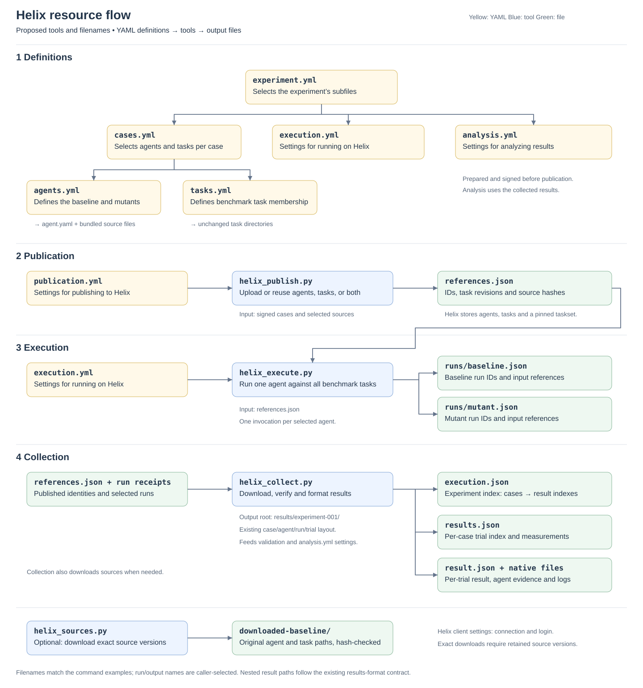

<!-- SPDX-FileCopyrightText: Copyright (c) 2026 NVIDIA CORPORATION & AFFILIATES. All rights reserved. -->
<!-- SPDX-License-Identifier: Apache-2.0 -->

# Helix benchmark architecture

The workflow has four tools: **upload agents and tasks**, **run an agent against a
benchmark**, **download results**, and **download sources**. This PR defines how those
tools should work. It contains only documentation and examples; later PRs will
implement the proposed commands.

## Resource flow



[Open the resource-flow SVG](assets/helix-resource-flow.svg).

Each execution command runs one agent against every task in the selected benchmark.
Collection downloads those runs into the experiment's standard results directory.
Sources only need downloading when a later step needs files that are not already
present and verified locally.

## Four tools

| Proposed tool | Purpose and inputs | Output |
| --- | --- | --- |
| `helix_publish.py` | Upload prepared agents, tasks, or both. Check existing resources before reusing them. | `references.json`: the Helix IDs and exact versions for each case's agents, tasks and benchmark taskset. Helix stores the published resources. |
| `helix_execute.py` | Read run settings from `execution.yml` and agent/taskset IDs from `references.json`. Run one selected agent against one case's benchmark. | `runs/baseline.json` or `runs/mutant.json`: run/job IDs and the exact agent and task versions used, linked to the case. |
| `helix_collect.py` | Download results, check what ran and whether results are complete, and write the standard format. Download missing sources when needed. | `execution.json`, a `results.json` for each case, and a `result.json` plus original output files for each trial, ready for validation and analysis. |
| `helix_sources.py` | Download the agent and/or task versions listed in `references.json` or a run receipt. | Verified source files at their original relative paths. Collection uses the same download operation when needed. |

These tools consume an already prepared experiment. Collection downloads results
and writes the standard results format in one step. After publication, the saved
references are sufficient to run on Helix and download published sources; the original
upload directory is no longer required.

`references.json` maps uploaded or reused agents, tasks and benchmark tasksets to
the Helix IDs and exact versions needed for execution and download. It retains the
experiment's case, agent and task IDs so each remote resource can be matched to its
prepared input.

The saved references are used to execute the experiment, download its sources and
results, and verify that results account for every selected agent and task. Their
IDs and exact versions identify the remote resources; the original local bundles
are not required. Execution records the references it used alongside the run IDs,
so collected results remain linked to what ran.

## Decisions

1. **Register agents separately.** Each baseline and mutant comes from its own signed
   bundle. Register it and upload its files to the agent's FileSet (Helix file storage),
   or check and reuse an existing registered version. Never put agent bundles in task images.
2. **Keep tasks unchanged.** Upload the prepared task directories without editing their
   Dockerfiles. To reuse a task already in Helix, select an exact revision and check
   that it matches the local prepared source.
3. **Publication uploads or reuses resources.** Publish agents, tasks, or both and return
   their references. A *taskset* is the benchmark's list of tasks, each fixed to an exact
   version. Publication does not choose compute, build task images or start evaluations.
   Execution handles any required image builds.
4. **The prepared experiment decides what runs.** It selects the cases, baseline,
   mutants and tasks. Signed agent definitions and manifests specify behavior, model,
   files and runtime options. Publishing or running the experiment must not change
   those choices. Here, *signed* means the input files have recorded content hashes;
   see [input signing](benchmark-format.md#references-and-content-pins).
5. **Execution uses saved references.** Run one agent against one benchmark taskset,
   using registered IDs and exact versions/content hashes. The original local bundles
   are not needed. Changing an agent never requires rebuilding task images.
6. **Published sources must be downloadable.** Keep the complete agent definition,
   bundled files and task sources. Check downloaded files against their recorded
   hashes before using them. If files are missing or have changed, report an error
   rather than downloading a newer version.
7. **A name does not prove which version ran.** Record the actual agent configuration,
   file hashes and task revisions for each run. Exact downloads require saved copies
   that cannot change. We still need to verify whether Helix retains old agent FileSet
   contents. If it does not, the implementation must save an unchangeable copy in Helix.
   A hash can detect an overwritten file, but cannot bring its contents back.
8. **Keep the same results format.** Preserve experiment IDs, selected agents and tasks,
   trials, attempts, statuses and original run evidence. Collection writes the existing
   [results format](results-format.md), so validation, scoring and analysis stay the
   same. Failed runs remain in the results.
9. **Registered agents initially run only on Helix.** Downloading an agent does not
   make it runnable locally. Local execution must report an error for unsupported
   registered agents. Existing native Harbor configurations and Oracle/NOP controls
   continue to work through their current path.

Run the execution command once for the baseline and once for each selected mutant.
To repeat the same agent against the same benchmark, save a separate run and choose
explicitly which run analysis should use. Do not automatically combine repeated runs
or change the existing [trial and scoring rules](stages.md#1-run-mutants-x-eval-tasks).

## What each configuration controls

| Input | What it controls or records |
| --- | --- |
| Experiment, cases and task manifests (`experiment.yml`, `cases.yml`, `tasks.yml`) | Which cases, agents and tasks are selected; task IDs and signed source hashes; links to analysis settings. |
| Agent manifest and bundle (`agents.yml`, `agent.yaml` and bundled files) | Baseline/mutant IDs, agent definition, models, instructions, files and runner options. |
| Helix client settings (saved client configuration, selected by `--context`) | Saved server connection, login and default workspace, shared by all four tools. |
| Publication settings (`publication.yml` or `publication-existing-task.yml`) | Where to publish, which secrets to use, and any exact resource versions to reuse. Cannot override models, runtime options or compute settings. |
| Execution settings (`execution.yml`) | Where jobs run (dispatcher), how many run at once, and sandbox resources. Can also check that the destination matches the published references. |
| Analysis settings (`analysis.yml`, referencing description and subset files) | Settings for analyzing results: case descriptions, fixed task subsets, coverage, scoring and missing-result handling. |
| Publication references and run receipts (`references.json`, `runs/baseline.json`, `runs/mutant.json`) | Helix IDs, exact versions and hashes linked to experiment IDs. A run receipt records the inputs actually used by that run. |

Credentials stay in the Helix client configuration or secret store. Source downloads retrieve
published files; they do not include secret values or Git history, or guarantee that
rerunning a model produces the same answer. Keep the signed experiment files and
analysis inputs with the references. These tools do not recreate them.

## Example workflow

These examples show the proposed commands, to be implemented in later PRs. They run
from `labs/metric-benchmark` and use a prepared, signed experiment at
`prepared/cases.yml`, with working agent bundles and tasks. `my-helix` is the saved
Helix connection and login. The example case is `example`; its agents are `baseline`
and `mutant`.

### 1. Upload resources and save references

```bash
python helix_publish.py --cases prepared/cases.yml \
  --resources agents,tasks --publication examples/helix/publication.yml \
  --context my-helix --output references.json
```

`--resources agents` uploads only agents; `--resources tasks` uploads only tasks.
You can publish them separately and combine their references:

```bash
python helix_publish.py --cases prepared/cases.yml \
  --resources agents --publication examples/helix/publication.yml \
  --context my-helix --output agent-references.json
python helix_publish.py --cases prepared/cases.yml \
  --resources tasks --publication examples/helix/publication-existing-task.yml \
  --context my-helix --references agent-references.json --output references.json
```

The second command keeps the agent references and adds the task and taskset references.
It reports an error if the mappings conflict. Only the sources being published need
to be available locally. The [existing-task settings](../examples/helix/publication-existing-task.yml)
show how to reuse a verified task version; tasks not listed there are uploaded.
The output records the IDs supplied by Helix and their exact versions.

### 2. Run one agent against all benchmark tasks

```bash
python helix_execute.py --references references.json --case example --agent baseline \
  --execution examples/helix/execution.yml --context my-helix \
  --output runs/baseline.json
python helix_execute.py --references references.json --case example --agent mutant \
  --execution examples/helix/execution.yml --context my-helix \
  --output runs/mutant.json
```

`--case` and `--agent` select the agent and benchmark taskset from `references.json`.
Execution uses their Helix IDs and exact versions without reading local source
directories. Each output JSON file is a *run receipt*: it records the run IDs, the
versions used and where to download their sources. Later changes to `references.json`
do not change that record of what ran.

### 3. Collect and format results

```bash
python helix_collect.py --references references.json \
  --run runs/baseline.json --run runs/mutant.json \
  --context my-helix --sources-output downloaded-sources \
  --output results/experiment-001
```

Collection checks that every selected agent has results for every task and reports
incomplete runs or missing evidence. It downloads any needed sources to `downloaded-sources`
and writes `execution.json`, each case's `results.json`, and the agent/run/trial
directories described in the [results format](results-format.md). Existing validation
and analysis use those files and the saved experiment definition. There is no separate
import command to run.

### 4. Download Helix sources

Download agent and task sources using their recorded Helix IDs and exact versions.
Use a run receipt to download the versions that ran, or `references.json` to download
the published versions.

```bash
python helix_sources.py --run runs/baseline.json \
  --resources agents,tasks --context my-helix --output downloaded-baseline
```

Use `--references references.json` instead of `--run` to download sources before execution. Use `--resources agents` or `--resources tasks` to download
only one kind. A run receipt selects the versions actually used by that run. Downloads
keep the original relative paths, check IDs and hashes, and report an error if existing
local files conflict.

### Configuration templates

The [example directory](../examples/helix) supplies:

- [Agent manifest](../examples/helix/agents.yml): separate registered baseline and mutant bundles.
- [Agent definition](../examples/helix/agent.yaml): a minimal managed agent configuration.
- [Execution](../examples/helix/execution.yml): compute settings.
- [Publication](../examples/helix/publication.yml): per-agent secret bindings.
- [Existing task](../examples/helix/publication-existing-task.yml): a pinned task revision to verify and reuse.

Supply working bundles and task sources, choose a model available in the destination
workspace, then sign the experiment. These templates are not a runnable benchmark.

## Running agents on Helix

Helix uses its Fabric adapter to run registered agents on Harbor tasks. Users only
need to register an agent bundle and select tasks. Helix handles making the agent
files available; users do not configure mounts or edit task Dockerfiles.

The example gives DeepAgents file tools the task container’s filesystem rooted
at `/`, so absolute paths in task instructions keep their meaning. This is the
container filesystem, not the machine submitting the run.

An agent still needs compatible tasks and a suitable worker: its dependencies,
setup permissions, network access and model must be available. Unsupported
combinations must produce clear errors, and setup failures must be kept with the
run's evidence.
