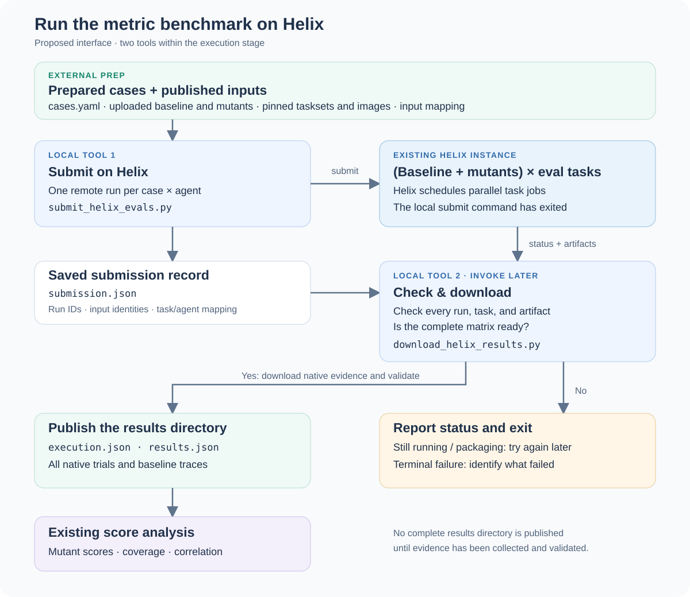

<!-- SPDX-FileCopyrightText: Copyright (c) 2026 NVIDIA CORPORATION & AFFILIATES. All rights reserved. -->
<!-- SPDX-License-Identifier: Apache-2.0 -->

# submit_helix_evals.py — proposal

Submit prepared cases to an existing NeMo Helix instance, then exit while Helix
runs the evaluations. **This is a design sketch; the command and configuration
below are not implemented.** The [local runner](run-evals.md) remains available.



[Open the diagram](assets/helix-execution.svg).

## Proposed usage

```bash
uv run python labs/metric-benchmark/submit_helix_evals.py \
  --cases cases.yaml \
  --execution helix-execution.yaml \
  --bindings helix-inputs.yaml \
  --run-id trial-1 \
  --output helix-run
```

- `--cases`: the existing [case definitions](benchmark-format.md#cases-casesyml)
  and their agent/task manifests. These remain the authority for matrix membership.
- `--execution`: Helix connection and scheduling settings, illustrated below.
- `--bindings`: a prep-generated mapping from those case, task, and agent IDs to
  their uploaded Helix inputs. This is a proposed companion file, not a change to
  `cases.yaml`.
- `--run-id`: the execution identifier carried into the downloaded results.
- `--output`: directory for `submission.json`, the local record used by the
  [download tool](download-helix-results.md).

Example execution settings, separate from cases and analysis:

```yaml
backend: helix
base_url: https://helix.example.com
workspace: metric-benchmark
dispatcher_profile: evaluation-workers
sandbox:
  profile: evaluation-sandbox
max_concurrent_task_jobs: 8
```

The URL and profiles are examples supplied by the Helix operator. Authentication
uses the operator-supported Helix client configuration; credentials do not belong
in these files. The concurrency limit applies to each submitted agent's run;
Helix also enforces instance-wide and caller limits. It is not a total budget
across all mutants.

## Prepared inputs

Prep has already published each case's tasks as a pinned Helix taskset, built its
environment images, and made the baseline and mutants executable on that instance.
The tool does not upload inputs, build images, provision Helix, or construct subsets.
The instance needs the native taskset-run API, its controller, and working
Kubernetes dispatcher/sandbox profiles, with access to the prepared images.

The upload manifest connects each case's task inventory to a taskset revision and
maps each task ID/revision to its member in that taskset. It also connects every
baseline/mutant ID and revision to a Helix agent target. Submission checks exact
membership against `cases.yaml`; neither extra remote tasks nor missing mutants
are accepted. The manifest must bind the published inputs to the prepared source
identities. Its detailed schema needs one real uploaded example before we fix it.

A registered agent name alone does not establish an immutable version. Helix
resolves registered agents at submission; the tool must check and save the resolved
identity against the prepared mapping. Converting arbitrary local agent bundles
into supported Helix targets remains a prep responsibility.

## Submission and recovery

Submit one Helix taskset run for each **case × (baseline + mutants)**. Helix
creates parallel task jobs within those runs. Each agent/task pair gets one trial,
with trial retries disabled; no analysis configuration or subset selection affects execution.

The tool saves an idempotency key and request before submitting each run, then
records the accepted Helix run ID. `submission.json` contains the instance and
workspace, benchmark run ID, case and execution identities, prepared-input mapping,
and remote run IDs. It contains enough saved metadata for later collection without
the original machine's executable task/agent directories, but no authentication secrets.

Rerunning the same command resumes submission from this record, using the same
keys under the same Helix caller. A lost response or interruption must not create
duplicate evaluations. Changed inputs require a new submission directory. Replaying
a submission does not retry a terminal failed evaluation; a deliberate rerun gets
a new run ID and directory. There is no automatic polling after submission.

## Python library and implementation boundary

A `submit_helix_evals(...)` library function would implement the same operation;
the CLI would only load arguments and report its result. The paired download
function would finish the execution stage. The benchmark needs no new service,
database, or UI. Analysis continues to consume saved results.

The target is Helix's native
[`agent-evaluate/runs` API](https://github.com/NVIDIA-NeMo/nemo-helix/blob/04e38c56dcbf1044c0574405c307f7937881bac9/plugins/nemo-evals/src/nemo_evals/api/v2/taskset_runs.py),
whose [request schema](https://github.com/NVIDIA-NeMo/nemo-helix/blob/04e38c56dcbf1044c0574405c307f7937881bac9/plugins/nemo-evals/src/nemo_evals/api/taskset_run_schemas.py)
supports stored tasksets, task-job concurrency, and idempotency keys. These source
links pin the inspected implementation; they do not establish deployment readiness.
Before implementation, the [download compatibility check](download-helix-results.md#compatibility-before-implementation)
must establish that its native evidence can satisfy the benchmark contract.
